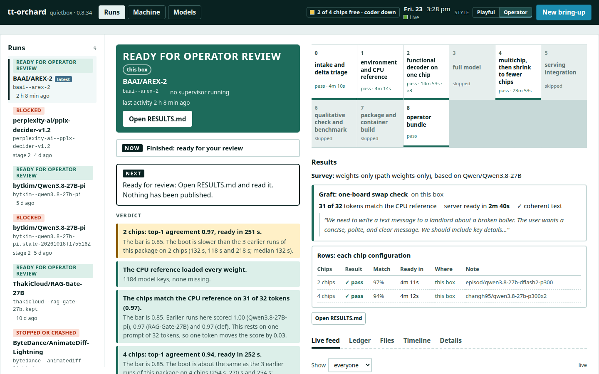
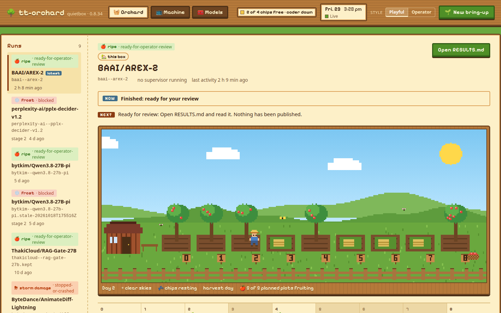
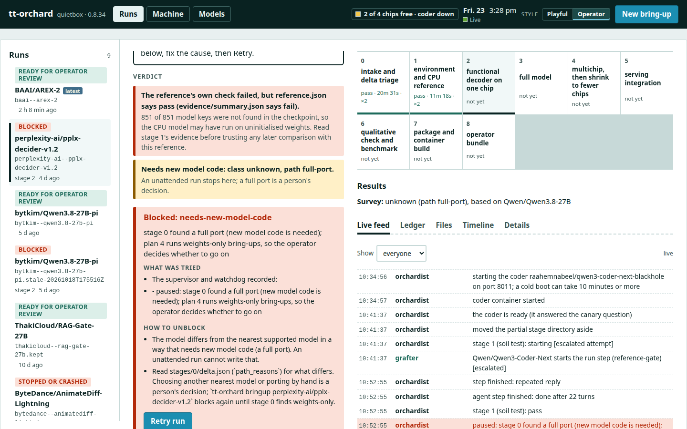
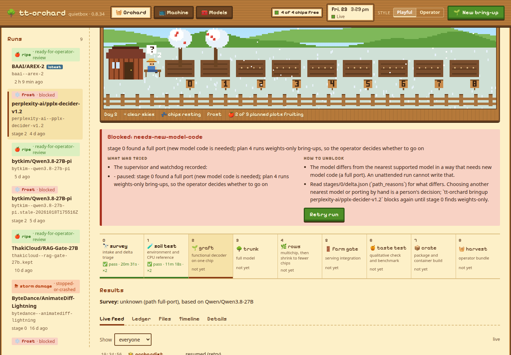
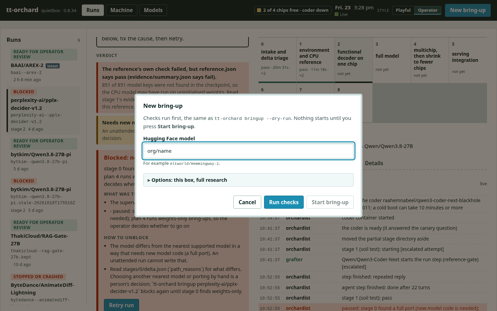
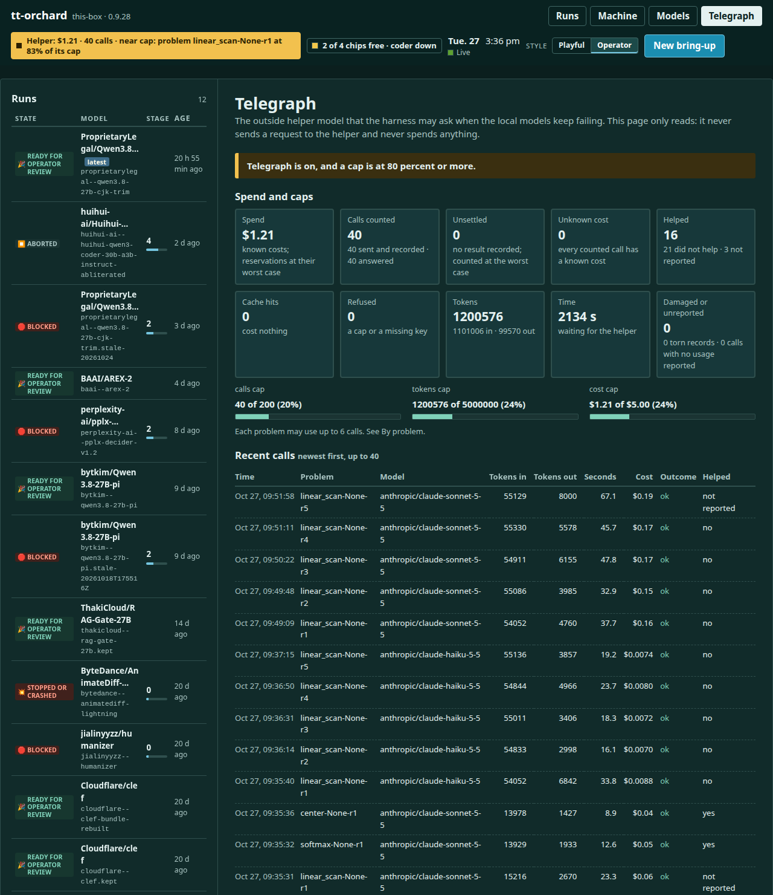
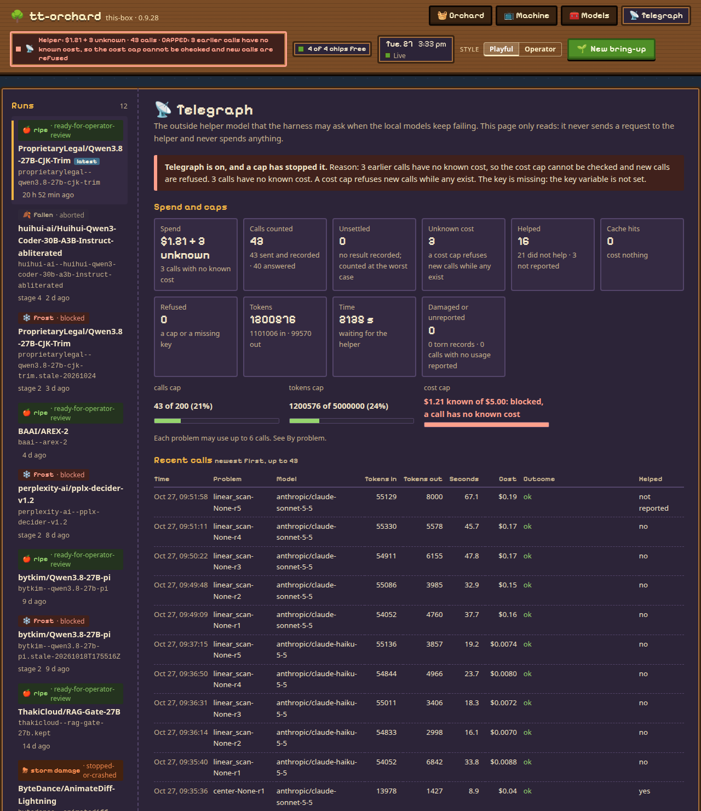

# tt-orchard

[Watch a real run replayed on the project site](https://tsingletaryTT.github.io/tt-orchard/) (source in `site/`).

A new model lands on Hugging Face. You own a QuietBox 2. You want to know whether it runs on your
Blackhole chips, and you want a package other people can serve with one command.

tt-orchard does that work on the box itself. You give it a model id:

```bash
tt-orchard bringup Cloudflare/clef
```

It downloads the model, works out how it differs from a model that already runs on Tenstorrent
hardware, writes and runs the tests, brings it up on the chips, checks its output against a CPU
reference, and tries it on 1, 2 and 4 chips. It stops at a review bundle: results, risks, a model card
and the publish commands as text, for you to read first.

> **Requires [tt-gozer](https://github.com/tsingletaryTT/tt-gozer).** tt-gozer leases the chips, so
> several agents can share one QuietBox 2 without opening a device at the same time. tt-orchard will not
> start a hardware step without a gozer lease. `scripts/setup.sh` installs it for you (see
> [the recommended setup](#recommended-setup-for-a-quietbox-2)), or follow
> [section 3.2](#32-install-tt-gozer).

## The mission

Bring up a model for a QuietBox 2, on a QuietBox 2, with only the compute the QuietBox 2 has.

- **No remote model service.** The agents that write and run the tests are open-source models served on
  the same machine. One p300 board serves the coder (Qwen3-Coder-Next). The CPU serves a fallback
  (`qwen3-coder:30b` through ollama). The other board stays free for the new model's hardware tests.
  Nothing calls out to a hosted model.
- **One box, shared fairly.** Every chip is leased through [tt-gozer](https://github.com/tsingletaryTT/tt-gozer).
  The supervisor never touches a chip it does not hold, and it never clears another agent's lease.
- **A model tells you what it needs.** Each model is sorted into a class: weights only, weights plus a
  sidecar, a trimmed vocabulary, a restricted head, a full port, or unknown. A weights-only model can finish in hours. A model that needs new code
  stops with a reason, and does not guess.
- **It can be left alone.** Every step, decision and evidence file goes into an append-only ledger. A run
  can be paused, resumed, and recovered after a crash. When it cannot go on, it stops as `blocked`,
  says why, and releases the hardware.
- **A person publishes.** The harness never publishes, pushes or uploads anything.

### What it has done

Every run below happened on one QuietBox 2 (four Blackhole chips, two p300c boards). The log in `docs/project-log.md` has the
details and the limits of each one. The evidence for each row is in `docs/run-logs/` or in the log.

| Model | What it is | Class | How far it got |
|---|---|---|---|
| `Altworld/Hemmingway-1` | Qwen3.8-27B fine-tune | `weights-only` | Attended run to `ready for operator review`; 2-chip and 1-chip packages published and the 2-chip one pulled and booted from the Hub |
| `iapp/openthai2.0-qwen3.8-27b` | Qwen3.8-27B fine-tune | `weights-only` | Packages published, 2-chip one pulled and booted from the Hub |
| `Cloudflare/clef` | Qwen3.8-27B post-train with a separate task head | `weights+sidecar` | One command to `ready for operator review` in about 3 hours of ledger time; `episod/clef-p300` is public (31 of 32 tokens equal to the CPU reference; pulled and booted from the Hub on 2026-10-26 with 2 chips, ready after 2,540 s) |
| `ThakiCloud/RAG-Gate-27B` | Qwen3.8-27B fine-tune (a retrieval gate) | `weights-only` | Ready for review, then packaged by hand and measured against a labelled set (0.930 on 200 items); `episod/rag-gate-27b-p300` is public and was pulled and booted from the Hub (reply 42, ready in 2,841 s) |
| `bytkim/Qwen3.8-27B-pi` | Qwen3.8-27B fine-tune | `weights-only` | First unattended run with the preflight and retry setup (six launches of one command, each stop explained); benchmarked at full size against its base; `episod/qwen3.8-27b-pi-p300` is public |
| `BAAI/AREX-2` | Qwen3.8-27B fine-tune with no `mtp.*` tensors and no generation config | `weights-only` | Passed after the harness learned to copy the nearest model's generation config. `episod/arex-2-p300` is public with the drafter off and sampling on the host; it was pulled and booted from the Hub. A by-hand graft of the nearest model's `mtp.*` head later kept the drafter on with the same agreement (issue 14); the supervisor's automatic graft trial has not run on hardware |
| `ProprietaryLegal/Qwen3.8-27B-CJK-Trim` | The nearest model with 66,533 vocabulary rows removed | `vocab-trim` | Supervised unattended run to `ready for operator review` in 2,804 s of ledger time (2 chips 30 of 32 tokens, 4 chips 30 of 32); packaged and boot-checked; not published |
| `huihui-ai/Huihui-Qwen3-Coder-30B-A3B-Instruct-abliterated` | Weights-only fine-tune of a model whose only installed package is a container package | `weights-only` | The first container run is not valid evidence: the package downloads its own hard-coded repository from the Hub and serves that base model, ignoring the model directory, so its 32 of 32 tokens describe the base. The harness now runs the container with the Hub switched off and fails such a test (issue 60 stays open; no catalog container has yet been shown to serve swapped weights except the Qwen3.8-27B ones) |

Not brought up, and why: `perplexity-ai/pplx-decider-v1.2` is a `restricted-head` model, so the run stops after stage 0 and a
person can ask for the parity report (14 of 14 answers agree); `nvidia/NVIDIA-Nemotron-3.5-Bolt-74B-A9B-24GB` stopped at the
preflight (no installed bundle serves its base); `Plurato123/OctLLM` needs CUDA decoders. No model that needs new model code
(the `full-port` path, stages 3, 5 and 6) has ever run. Issue 61 tracks a first pilot.

Those runs were not all hands-off. The early ones blocked, and each cause was a bug in tt-orchard, fixed before the same
command was run again. The later ones needed a person for disk space and for a restart after a power event, and each of those
is now a preflight check or a block message. The harness has never run end to end with nobody touching the machine.

## Contents

0. [Recommended setup for a QuietBox 2](#recommended-setup-for-a-quietbox-2)
1. [Status](#1-status)
2. [What you need](#2-what-you-need)
3. [Install](#3-install)
4. [Run a bring-up](#4-run-a-bring-up)
5. [Operate a run](#5-operate-a-run)
6. [Lessons that will bite you](#6-lessons-that-will-bite-you)
7. [Where things are](#7-where-things-are)
8. [Safety and license notes](#8-safety-and-license-notes)
9. [License](#9-license)

## Recommended setup for a QuietBox 2

On a QuietBox 2 (two p300 boards, four chips), run the setup script first. It checks each prerequisite,
installs [tt-gozer](https://github.com/tsingletaryTT/tt-gozer) (the chip lease manager tt-orchard needs) when it is missing, and writes the machine config. It never resets a chip, never takes or
releases a lease and never publishes anything. It never overwrites a config file that already exists.

```bash
git clone https://github.com/tsingletaryTT/tt-orchard.git
cd tt-orchard
scripts/setup.sh --check      # report only; runs nothing
scripts/setup.sh              # asks before each step that changes the machine
scripts/setup.sh --yes        # does every step without asking
```

Options: `--coder {coder-next,coder-next-v1,27b}` (default `coder-next`), `--yes`, `--check`, `--start-ollama` (starts
`ollama serve` in the background when it is down), `--runs-root`, `--venv-dir` and `--gozer-dir`.

What it covers: Python 3.12 or newer; tt-gozer 0.3.2 or newer with `acquire --owner-pid` and `reset`
(cloned and installed from [tt-gozer](https://github.com/tsingletaryTT/tt-gozer) when absent; stale leases and busy
chips are reported as warnings and left alone); `tt-model`; docker; the `hf` CLI; ollama and its CPU-tier
model; 1 GB hugepages; a reference Python environment with CPU torch for stage 1; the coder's tt-model
package; and the config files `config/tiers.toml` and `config/bringup.toml`, written from the
`config/*.qb2-*.toml` templates. On other hardware it prints a warning and writes no config.

### Why Coder-Next is the default on a QuietBox 2

`raahemnabeel/qwen3-coder-next` on one board (the `p300` profile) is the suggested agent model. It is the
Qwen3-Coder-Next checkpoint with a fused decode step, and it has been the default since 2026-10-28. It leaves
the other board free for the bring-up's hardware tests, so most stages need no park and restore of the coder.
The earlier choice, Qwen3.8-27B on all four chips, holds both boards, so every hardware stage parks it.

Evidence, from [the fused-decode run](docs/run-logs/2026-10-28-coder-fused-decode.md): it passed the same
role-fit test as the earlier package (50 of 50 replayed agent turns well formed, none of the 35 replays of the
27B's failure turns repeated a failure). The kernel probe's decode-speed check measured a median of
79 tok/s (28 samples, 43 to 108) on it, against 38.5 to 38.6 tok/s recorded for the earlier package. The new numbers vary with how busy the host is, and
the run log gives the samples and the conditions. The earlier package ran the first full Clef bring-up to
`ready for operator review` (see the log in docs/project-log.md). The new bundle has not yet run a whole
bring-up.

Limits: the new bundle's numbers come from one session on a shared host, and the earlier package's numbers come
from recorded reports and were not taken in the same hour. The `p300` profile uses bfp4 routed experts, and whether that
affects tool-call reliability over many runs is not measured. Check it on your own machine with
`python3 -m orchard.rolefit` (section 5.3b) before relying on it.

The fallback is the earlier package, `raahemnabeel/qwen3-coder-next-blackhole`: run
`scripts/setup.sh --coder coder-next-v1`. Its config templates are `config/*.qb2-coder-next-v1.toml`. To use
the 27B instead, run `scripts/setup.sh --coder 27b`; its templates are `config/*.qb2-27b.toml`.

Setup never overwrites a config file that exists. A machine that already has `config/bringup.toml` keeps its
`[coder] target`, so after the default changed it still runs the package it had. To switch it, install the other
package (`tt-model pull <package>`; `scripts/setup.sh --coder <name>` does that and reports what it left alone) and
edit `target` under `[coder]` in `config/bringup.toml` to `raahemnabeel/qwen3-coder-next` (the default) or
`raahemnabeel/qwen3-coder-next-blackhole` (the fallback). `config/tiers.toml` needs no edit: both packages answer
to `Qwen/Qwen3-Coder-Next`. Stop the old coder first; the two packages use different container names.

## 1. Status

tt-orchard is early. It has brought up eight models, all on one machine: a Tenstorrent QuietBox 2 with two p300c boards (four
Blackhole chips). Seven are Qwen3.8-27B-family models and one is a Qwen3-Coder-30B-A3B fine-tune; the table under
[What it has done](#what-it-has-done) lists them. Nothing has been run on any other machine, and no model that needs new model code
has been run.

What is shown, and by what:

- **Weights-only, weights+sidecar and vocab-trim models reach `ready for operator review`.** Stages 0, 1, 2, 4 and 8 (and 7 when
  `--package-format v6` is given) passed on real chips for Hemmingway-1, openthai, Clef, RAG-Gate-27B, bytkim, AREX-2 and CJK-Trim. Stages 3, 5
  and 6 are skipped on that path by design.
- **A package a run produced can be pulled and booted from the Hub.** Six published packages were checked from a clean install
  (Hemmingway-1, openthai, RAG-Gate-27B, AREX-2, Clef and bytkim). The Clef and bytkim checks (2026-10-26, 2 chips, no token, empty caches) were ready after 2,540 s and 3,181 s and answered a short question correctly (issue 24).
- **The fidelity evidence is still thin.** Each configuration is compared with the CPU reference on 32 tokens of one prompt, and since
  2026-10-23 on eight fixed prompts that are read for failure shapes. The prompt suite has run on real chips without a control, so its
  bars are choices and not measurements (issue 15). Full benchmarks exist for bytkim only (HumanEval, MBPP, GSM8K, IFEval and BFCL against its base, with the
  cut-off replies asked again at a larger token limit).
- **An unattended run still stops for causes outside the model.** The ones seen: disk space (issue 27), a 4-chip fabric timeout that
  a reset does not always clear (issue 26), a board that dropped off the bus (issue 25) and an agent that loops when the harness drafts nothing (issue 68).
- **The container path (a v5.1 package as the nearest model) has not yet shown a swapped model served.** The one real run used `raahemnabeel/qwen3-coder-30b-a3b`, whose generator downloads its own hard-coded repository, so the test measured the base model. The 4-chip container tests of the Qwen3.8-27B runs did not fetch anything (their isolated Hugging Face directory stayed empty), so those results stand. The harness now runs a test container with the Hub switched off and fails a test that fetched a model (issue 60 stays open).

The suite has 7,177 passing tests and 3 skipped (measured with `python3 -m pytest -q`).

### Stages

| # | Stage | On real hardware |
|---|---|---|
| 0 | Intake and delta triage against the nearest supported model | A template script (`delta_triage.py`) measures from safetensors headers and drafts `delta.json`; the agent reviews it. Ran on every model in the table above except Hemmingway-1 (whose run used the earlier open-ended skill, with the agent writing its own comparison scripts) and decided the class each time: `weights-only` (most), `weights+sidecar` (Clef), `vocab-trim` (CJK-Trim) and `restricted-head` (pplx-decider). The vocabulary check takes about 8 seconds on a 27B model. A classification bench ran it on 42 models without downloading weights and matched the majority of three blind model labelers on 39 of 40 |
| 1 | Environment and CPU reference | A template script (`reference_gate.py`) loads the model on CPU, runs four checks and drafts `reference.json`. The gate compares the agent's file with the script's own evidence, so a reference whose weights did not load fails. Passed on the runs since Hemmingway-1 (which used the earlier open-ended skill), in 4 to 11 minutes |
| 2 | Functional decoder on one chip; on the weights-only path, a weights swap on one board | Passed for every weights-only, sidecar and vocab-trim model: the chips agreed with the CPU reference on 29 to 32 of 32 tokens (and, on runs since 2026-10-23, the eight-prompt suite found nothing blocking). For a model whose nearest model has only a container package, it serves through the container on the package's own chip count (4 chips in the one real run) |
| 3 | Full model | Skipped by design on the weights-only path. Never run on the full-port path |
| 4 | Multichip, then shrink to fewer chips; on the weights-only path, one test per chip configuration | Passed on 2 and 4 chips (1 chip optional) for Clef, RAG-Gate-27B, bytkim, AREX-2 and CJK-Trim. The 4-chip test has hit fabric timeouts that a reset does not always clear (issue 26). Did not pass for a container-only package with no 2-chip configuration (issue 68) |
| 5 | Serving integration | Skipped by design on the weights-only path, because stage 4's tests boot each configuration and compare the output with the CPU reference. Never run on the full-port path |
| 6 | Qualitative check and benchmark | Skipped on the weights-only path. The full benchmark that exists (bytkim) was run by hand with `orchard.bench_session` and is described in `docs/run-logs`. Never run on the full-port path |
| 7 | Package and container build | Supervisor code, opt-in with `--package-format v6`, or run on a finished run with `tt-orchard package`. Staged and boot-checked packages for Hemmingway-1, openthai, Clef, RAG-Gate-27B, bytkim, AREX-2 and CJK-Trim, with a gate that checks the card against the package's files (drafter state, borrowed generation config, grafted head, reported scores kept apart from measured ones). A v5.1 container package is refused at start |
| 8 | Operator bundle | A template script (`build_bundle.py`) builds `RESULTS.md`, `RISKS.md`, `card.md`, the packages and the publish commands as text from the run's files, and the supervisor runs the stage's gate on the result (scrub, hazards, files). Every run in the table that reached the end passed it. Nothing is published by the harness |

The full-port path (a model that needs new model code) has never run. When stage 0 chooses it, the
supervisor pauses before stage 2 for the operator.

**Matching a model to its nearest one.** Stage 0 pairs the two models' tensors the way a person would. Names the
`model.language_model.` rule leaves over are paired by what they share (`language_model.layers.5...` and
`model.language_model.layers.5...`), and the pairs and prefix rewrites are recorded in `delta.json` under
`alignment`. `evidence/value-compare.json` samples the paired tensors' values (identical, near, changed or unrelated;
a fine-tune is near), and `evidence/head-compare.json` says whether a sidecar is the nearest model's `lm_head` cut down
to some rows. When the backbone lines up and every row of a sidecar matrix is a copy of an `lm_head` row (the first such
model was `perplexity-ai/pplx-decider-v1.2`: 255 answer-code rows), the class is `restricted-head`. The harness does not
serve those models: the run stops after stage 0 with the block code `restricted-head` and says what it found, because
how the rows are read (at marker tokens, under a different attention mask) is in the model's own code. The stage 1
gate now compares the stage agent's `reference.json` with the reference template's own evidence, and fails a reference
whose weights did not load. It also compares a stage's copy of `delta_triage.py` and `reference_gate.py` with the shipped file and fails the stage if
they differ: on the pplx-decider run the stage agent edited its copy of the reference script, and that, not the template, is why no weights loaded.
After a restricted-head stop an operator can ask for a measured report of whether the chips give the model's own readout the CPU's answers
([docs/restricted-head-parity.md](docs/restricted-head-parity.md); first result: 14 of 14 answers agree, largest probability difference 0.048,
against 0.47 for a runtime that applied a causal mask).

### Parts

| Part | Files | State |
|---|---|---|
| Run ledger | `orchard/ledger.py` | Built and tested. Used on the real run |
| Command runner (the shell guard for agents) | `orchard/runner.py` | Built and tested. Best effort; see [Safety](#8-safety-and-license-notes) |
| Tier config loader | `orchard/tiers.py` | Built and tested. Used on the real run |
| Lease adapters (gozer, single tenant) | `orchard/adapters/` | Built and tested. The gozer adapter was used on the real run. The single-tenant adapter is tested with fakes only and the command line does not offer it |
| Server control and canary | `orchard/server.py`, `orchard/canary.py` | Built and tested. Used on the real run |
| Park and restore | `orchard/handoff.py` | Built and tested. The park check ran on one real board with fake model servers, and real runs park and restore the coder for every 4-chip test (the first was Clef's) |
| Watchdog | `orchard/watchdog.py`, `orchard/transcripts.py` | Built and tested. Fired on a real agent during the run. The near-duplicate command check (command shapes, 4 turns) was added after the second-model run and has not fired on a real agent yet |
| Stage machine, agent loop, supervisor | `orchard/stages.py`, `orchard/agent.py`, `orchard/context.py`, `orchard/supervisor.py` | Built and tested. Ran stages 0 to 2 on the real run |
| Crash recovery | `orchard/supervisor.py`, `orchard/handoff.py` | Tested with fakes by killing the supervisor after every ledger event. On hardware: `kill -9`, restart, resume worked at least four times on the real run |
| Stage skills | `orchard/skills/` | The skills for stages 0, 1, 2, 4, 7 and 8 and the template scripts they copy have run on real runs. `serving-check` (stage 5) has never run, because stage 5 is skipped on the weights-only path. Stage 8 and stage 7 are supervisor code that runs `operator-bundle-templates/build_bundle.py` and `package.py` |
| Packaging (stage 7) | `orchard/package.py`, `orchard/package_card.py`, `orchard/package_cmd.py`, `orchard/package_templates/` | Built and tested with fakes, then run once on hardware (Hemmingway-1; see stage 7 above). Wired into the stage table as opt-in supervisor code. `tt-orchard package` and `package-card` run the same steps on a finished run and record them in its ledger. `tt-orchard reported` (`orchard/reported_cmd.py`) accepts the author-reported scores that stage 0 drafts from the model card. A v5.1 container package is refused at start |
| Bundle and package scrub | `orchard/scrub.py` | Built and tested with fakes. The stage 8 gate calls it; it ran once on the real run |
| CPU sizing tool | `orchard/sizing.py` | Built and tested against a fake server. It has not been run against a real ollama. The CPU numbers in this README come from the run log |
| `tt-orchard` command | `orchard/cli.py`, `orchard/bringup_config.py`, `orchard/preflight.py`, `orchard/fetch.py`, `bin/tt-orchard` | Built and tested with fakes, then used for the Clef run on the development machine (the preflight, the download check, the unattended end states and the retry path all ran for real) |
| Outcome classes, blocked end state | `orchard/classes.py`, `orchard/blocked.py` | Built and tested with fakes. Both were used by the Clef run: the class `weights+sidecar` through stages 0, 2, 4 and 8, and the blocked end state twice, with a retry each time |
| Sidecar parity | `orchard/skills/sidecar-parity-templates/` | Built by a forked agent and run on one leased board with Clef (15 of 16 questions agree), then run inside the supervisor's stage 2 after a swap check in the same lease with the same numbers |
| Role-fit test | `orchard/rolefit.py` | Built and tested with fakes, then run against Qwen3-Coder-Next on one board (result in `docs/run-logs`) |
| Container package as the nearest model | `orchard/swap_draft.py`, `orchard/supervisor.py`, `orchard/nearest.py` | Built and tested with fakes. The one real run found the package served the base model it downloaded; the hub-fetch check (Hub off, fetch fails the test) came from that. Stage 4 for such a package is issue 68 |
| Vocabulary trim and dtype tolerance | `orchard/skills/delta-triage-templates/`, `orchard/skills/weights-swap-templates/prepare_swap.py` | Ran on real chips: CJK-Trim (supervised unattended run) and `sabi-noema` (a hand swap) |
| Graft trial (a drafter for a model with no `mtp.*` tensors) | `orchard/graft_trial.py`, `orchard/skills/weights-swap-templates/` | Built and tested with fakes. The by-hand version of the same graft ran on AREX-2 and its package is public; the supervisor's trial has not run on hardware |
| Prompt suite and fidelity gates | `orchard/prompt_suite.py`, `orchard/skills/weights-swap-templates/prompt_suite.json` | Built and tested. Run on real chips for CJK-Trim, `sabi-noema` and the container run, with no control; no bar is measured (issue 15) |
| Benchmark tooling | `orchard/bench_session.py`, `orchard/bench_proxy.py`, `orchard/bench_control.py`, `orchard/bench_rerun.py`, `orchard/toolcall_bench.py`, `orchard/lm_eval_tasks/` | Ran for the bytkim and AREX-2 benchmarks (9.8 hours of chip time for bytkim). Run by hand, not by the supervisor |
| Package cards and gates | `orchard/package_card.py`, `orchard/card_use.py`, `orchard/package_cmd.py` | Used for the published cards. The gate checks the card against the files the package ships |
| Classification bench | `orchard/classify_bench.py`, `docs/classify-bench/` | Ran on 42 models without downloading weights; the tool agrees with the majority of three blind model labelers (opus, sonnet and fable; no person labeled) on 39 of 40 |
| Preflight checks | `orchard/preflight.py`, `orchard/bus.py`, `orchard/sfpi.py`, `orchard/skillsfresh.py`, `orchard/dlprogress.py` | Tests with fakes; the disk, base and cpu rows blocked real runs correctly; the sfpi row is fitted to three observations. The bus row has run only on a healthy box |
| Browser UI | `orchard/webui.py`, `orchard/web/` | Used against real runs in a browser; the browser tests run where `playwright` and Chrome exist |
| Kernel probe (can the local coder write a tt-lang kernel) | `orchard/kernelprobe.py`, `orchard/opinventory.py`, `orchard/ttlang_env.py` | Four ops were tried. `add` and `silu_mul` passed the simulator and then ran on a chip. `rmsnorm` and `linear_scan` never passed the simulator, so they were not run on a chip. Not part of a bring-up |
| Hardware-check driver | `orchard/hardware_check.py` | Ran on both boards of the development machine, 22 to 24 checks passed per run |
| Park-check driver | `orchard/park_check.py` | Ran once, on one board, with fake model servers. Exit 0, two resets of 41.7 s each (measured) |

### Tests

The suite has 7,177 passing tests and 3 skipped tests (measured with `python3 -m pytest -q`, about 15 minutes). It needs no hardware and
no network. The three skipped tests are opt-in: one replays local agent transcripts (`ORCHARD_REPLAY=1`), one asks the real Hugging Face hub and GitHub
(`ORCHARD_LIVE_RESEARCH=1`), and the browser tests of the web page run only where the `playwright` package and Chrome are present (issue 31).

### Development notes

Code that reads a file or a record that something else wrote (a model's output, an earlier run, a download) uses `orchard/safeio.py`, which holds the
guards for the failures that reviews keep finding: a link swapped in after a check, a read with no size limit, NaN, repeated keys, deep nesting, a safetensors
header that does not add up, an atomic write that can be raced. [docs/safe-reading.md](docs/safe-reading.md) says when to use each function and what it does not cover,
and gives a checklist for reviewing a new reader. `tests/hostile_inputs.py` holds a corpus of hostile inputs and a registry of the readers tested
against it. `hypothesis` drives the property tests in `tests/test_safeio.py`, with a fixed seed so that a failure reproduces.

## 2. What you need

Everything below was checked on the development machine only. Items marked
**not verified outside the development machine** have no evidence from any other host.

### Hardware

- Tenstorrent Blackhole boards. Development used a QuietBox 2 with two p300c boards, which is four
  chips. Other Blackhole systems are **not verified outside the development machine**.
- The chip counts the harness tests (1, 2 and 4) come from the packages that exist for the
  development machine. A machine with a different board count needs a different
  `--required-chips` value and packages for its own chip counts.

### Host software

| Software | What it is for |
|---|---|
| Linux | The only operating system used |
| Python 3.12 or newer, pytest and hypothesis | Runs tt-orchard and its tests. tt-orchard has no runtime pip dependencies; pytest and hypothesis are for the tests only (`pip install pytest hypothesis`; the `dev` extra in `pyproject.toml` lists the same two). `tests/test_lm_eval_code_tasks.py` also needs PyYAML (`pip install pyyaml`) |
| [tt-gozer](https://github.com/tsingletaryTT/tt-gozer) with the `reset` command (version 0.3.2 or newer) | Chip leases. The supervisor holds every board under a gozer lease |
| `tt-model` ([tt-model-manager](https://github.com/tenstorrent/tt-model-manager)) | Serves the models the agents use and the models under test |
| `tt-smi`, the Tenstorrent kernel driver and firmware | Device access. The supervisor reads `tt-smi -s` once at the start of a run to record firmware versions |
| docker | Runs container packages |
| ollama | Serves the CPU tier |
| git | Getting the code |
| Hugging Face access | Downloading the new model's weights before the run. After the download the stages need no Hugging Face access; the harness does not isolate the network |

### Disk

All numbers are for a Qwen3.8-27B-sized model.

| Item | Size |
|---|---|
| The new model's weights | About 51 GB (measured, Hemmingway-1, 13 safetensors files) |
| One converted tensor cache, 2-chip bundle | 34 GB (measured) |
| One converted tensor cache, 4-chip container | 31 GB (measured) |
| One converted tensor cache, 1 chip | Not measured |
| Free space the supervisor requires before stages 2, 3, 5 and 6 | 40 GB each (choice) |
| Free space before stage 4 on the weights-only path | 110 GB (choice), plus 40 GB again before each configuration's test (choice) |
| Free space before stage 7 (packaging) | 80 GB (choice): an installed copy of the package, its venv and a fresh tensor cache |

The preflight adds up the model, the nearest model's snapshot when it must be fetched, and a 40 GB margin for the hub disk and another for
the tensor-cache disk (the two margins add when they share a disk). It blocks as `disk-full` when the disk is short; for a 30B-class model whose base
was also missing, the sum was 202 GB. The preflight does not include stage 4's own requirement of 110 GB free at entry, so a run can pass it and
still block at stage 4 (the container validation run did, with 23.7 GB free). The block message lists the largest hub models and tensor caches
on the short disk so you can see what to remove; the harness removes none of the hub models. `bringup --prune-caches` removes only the oldest
tensor caches that no unfinished run uses, and only enough to fit (issue 27 tracks deleting a configuration's cache after its test passes).

Each chip configuration needs its own tensor cache. The supervisor checks free space only on the
filesystem that holds the run directory. On the development machine the root disk was 99% full, so
the run directory, the tensor caches and the model weights all lived on a second, larger disk. Put
them on a disk with room before you start.

### Memory

The CPU tier on the development machine is `qwen3-coder:30b` on ollama (a mixture-of-experts model,
about 3 billion active parameters, 4-bit). Measured with the chips idle: 14.1 tokens/s decode and
93 tokens/s prefill on a 1,605-token prompt. Its speed while a chip model is serving, and how
reliably it makes tool calls, are not measured. The host had 249 GB of RAM, and 133 GB was
available with that day's workload. The model needs about 18 GB at 4-bit (an estimate from its
size). A dense 27B model on the same CPU measured 0.70 tokens/s decode, which is too slow for agent
steps. These numbers are **not verified outside the development machine**.

## 3. Install

### 3.1 Get the code and run the tests

On a QuietBox 2, use `scripts/setup.sh` instead of sections 3.2 to 3.7 (see the recommended setup above).
To set up by hand:

```bash
git clone https://github.com/tsingletaryTT/tt-orchard.git tt-orchard
cd tt-orchard
python3 -m pip install pytest hypothesis    # the test tools (the `dev` extra in pyproject.toml lists the same two)
python3 -m pytest -q
```

Expect every test to pass except 3 skipped (opt-in tests; see Tests above). The suite took about 15 minutes on the development
machine (measured). The tests use fake hardware,
fake model servers and fake gozer state. They touch no device and no network. If a test fails
here, stop and find out why before going further.

### 3.2 Install tt-gozer

[tt-gozer](https://github.com/tsingletaryTT/tt-gozer) is required. It is the only thing that decides which
agent may open which chip, and the supervisor holds every board under a gozer lease for the whole run.
`scripts/setup.sh` does this step. By hand:

```bash
git clone https://github.com/tsingletaryTT/tt-gozer.git
cd tt-gozer && ./install.sh
```

Then check that `gozer status` lists your boards and that `gozer reset --help` works. You need version
0.3.2 or newer. Read the tt-gozer README before you share the box with other agents.

### 3.3 Install tt-model and a bundle for the nearest supported model

Install `tt-model` by following the
[tt-model-manager README](https://github.com/tenstorrent/tt-model-manager). It is not on PyPI.

The harness does not write new model code on the weights-only path. It loads the new model's
weights into an existing tt-model package of a model with the same architecture (the "nearest
supported model"). So you need an installed bundle or container package for that architecture,
for each chip count you want to test. You also need one to serve the agents' own model (the
"coder").

Examples from the development machine. These are examples only; pick the packages that match your
model and your hardware:

- 2 chips: the bundle `episod/qwen3.8-27b-dflash2-p300`.
- 4 chips: the container package `changh95/qwen3.8-27b-p300x2` with profile `batch32`.

A container (v5.1) package can also be the nearest model for stage 2. Most catalog container packages report 4 chips (2 boards, as
their `p300x2` names say), and stage 2 then serves the new weights on 4 chips (the coder's board is parked for the test). The
preflight only warns that a container base is used when exactly one installed package serves the base on the stage's chip count and has a
default profile; it does not check that. The check happens when stage 2 drafts its config, after the coder has started, so a base with no
fitting package leaves the stage to the agent (see issue 67). Stage 4 does not yet handle a package that has no
smaller configuration (issue 68). A v6 bundle that fits is always preferred.

```bash
tt-model pull <PACKAGE_ID>
tt-model list
```

Serve each package once by hand under a gozer lease, and check that it answers sensibly, before a
run depends on it. See [lessons](#6-lessons-that-will-bite-you) for why.

### 3.4 Install ollama and pull the CPU-tier model

The CPU tier keeps a model answering while the chips are busy with a hardware test. Install ollama
from its own instructions, start it, and pull the model:

```bash
ollama pull qwen3-coder:30b
curl -s http://127.0.0.1:11434/v1/models
```

The second command must list `qwen3-coder:30b`. The supervisor never starts or stops ollama. The preflight has a `cpu` row that
blocks a run when ollama does not answer or does not list the tier's model (a machine that has been suspended often has ollama
down). If the models live outside `~/.ollama`, start it with `OLLAMA_MODELS=<DIR> ollama serve`.

### 3.4a Build the demo interpreter (stock-runtime runs)

A run that tt-transformers already supports (class `stock-runtime`) runs tt-transformers' own demo from the host tt-metal tree. The
shared TT venv cannot run it: numpy 2.5.3 against ttnn's `numpy<2`, a `cv2` that does not import and a `datasets` that does not import.
Build a dedicated interpreter once and name it in `bringup.toml`:

```bash
tt-orchard demo-env --dry-run      # say what it would do
tt-orchard demo-env                # build ~/orchard-venvs/tt-demo (about 5 to 10 GB, needs the network)
tt-orchard demo-env --check        # check it; imports no ttnn and opens no device
# then in config/bringup.toml:  demo_python = "<HOME>/orchard-venvs/tt-demo/bin/python"
```

Section 5.9f describes what it installs and checks. The host tree must be built and at a release tag (for example v0.80.0).

### 3.5 Download the new model's weights

`tt-orchard bringup <MODEL_ID>` downloads the weights itself (and the nearest model's, when that snapshot is missing), shows a
progress bar, and records the revision it fetched. The agents' environment carries no Hugging Face token or other credential. It is not network-isolated: the command runner refuses most network writes and allows read-only fetches. A gated model is a block, because
the harness never uses your token. `bringup` blocks a gated model even when its weights are already cached, so download it yourself and use the lower-level `run` command with `--input model=<SNAPSHOT_DIR>` (section 4.2).

To use the lower-level `run` command, or to fetch ahead of time, download by hand:

```bash
hf download <MODEL_ID> --cache-dir <HF_HOME_DIR>/hub
```

Note the snapshot directory it prints. You pass it to `run` as `--input model=...`.

### 3.6 Write the tier config

```bash
cp config/tiers.example.toml config/tiers.toml
```

`config/tiers.toml` is ignored by git. Edit it. It has three parts.

**`[tiers.<name>]`**, one table per model. Each needs:

| Key | Meaning |
|---|---|
| `role` | A short description, for people |
| `endpoint` | The model server's OpenAI-compatible URL, for example `http://127.0.0.1:8000/v1` |
| `model` | The model id the server lists at `/v1/models` |
| `placement` | `chips` or `cpu` |
| `context_tokens` | Optional. The context length, a positive integer |

**`[stages.<n>]`**, one table for each stage 0 to 8. Each names tiers by name:

| Key | Meaning |
|---|---|
| `run` | The tier that does the stage's work. Stage 7 must say `"none"` |
| `diagnose` | The tier that takes over when the stage escalates. Required for stages 2, 3 and 4 |
| `plan` | The tier that plans. Required for stage 4 and refused on every other stage |

**`[escalation]`** with one key, `default`: the tier that takes over when a stage without a
`diagnose` tier (0, 1, 5, 6 and 8) escalates.

The loader refuses, with a message, any of the following:

- a value that still contains `CHANGE-ME`;
- an endpoint whose host is not `127.0.0.1`, `localhost` or `::1`, or whose scheme is not http or
  https;
- an unknown key or table anywhere (it suggests the closest known key);
- a missing stage, a stage that names an undefined tier, or a stage 7 with a model;
- a config with no `cpu` tier (the CPU tier stands in while a chip model is stopped);
- a tier named `none`.

The development machine used three tiers. Its tier tables were:

```toml
[tiers.large]
role = "plan and diagnose"
endpoint = "http://127.0.0.1:8000/v1"
model = "Qwen/Qwen3.8-27B"
placement = "chips"
context_tokens = 262144

[tiers.small]
role = "routine steps while one board is free"
endpoint = "http://127.0.0.1:8001/v1"
model = "Qwen/Qwen3.8-27B"
placement = "chips"
context_tokens = 262144

[tiers.cpu]
role = "stand-in while the large model is parked, and short steps"
endpoint = "http://127.0.0.1:11434/v1"
model = "qwen3-coder:30b"
placement = "cpu"
```

Its `[stages]` and `[escalation]` tables were the same as in `config/tiers.example.toml`. When a
stage's tier is not serving and another chip tier with the same model id is, that tier serves the
step and the ledger records the substitution. On that machine only one chip server ran at a time
(the coder on port 8000), so it served every step.

### 3.7 Machine paths

You do not edit any skill for your machine. Where a skill needs a path on the machine, it holds a
placeholder, and the supervisor fills it in before the agent reads the skill:

| Placeholder | Value | Override |
|---|---|---|
| `{{ORCHARD_DIR}}` | The tt-orchard checkout the supervisor runs from | none |
| `{{HF_HOME}}` | `$HF_HOME`, else `<operator home>/.cache/huggingface` | `--hf-home` |
| `{{OPERATOR_HOME}}` | Your home directory from the passwd entry | `--operator-home` |
| `{{TT_MODEL_ROOT}}` | `<operator home>/.cache/tt-model/models`, where tt-model installs bundles | follows `--operator-home` |
| `{{CACHE_ROOT}}` | `<parent of the run directory>/cache`. Each chip configuration's tensor cache goes in `<CACHE_ROOT>/<model slug>/<N>chip-<package>/tt_cache` | `--cache-root` |

Put the run directory on a disk with room for the tensor caches (see [Disk](#disk)), or pass
`--cache-root`. The ledger's `run_start` entry records all five values. A resumed run uses the
recorded values, and a resume that passes a different `--cache-root`, `--hf-home` or
`--operator-home` is refused. A skill that holds an unknown placeholder blocks its stage with a
message that names the placeholder and the file. The free-space check looks only at the run directory's disk. A
`--cache-root` on another disk is not checked, so check its free space yourself.

`orchard/hardware_check.py` has no built-in machine paths. Pass `--gozer` (a gozer that has
`reset`), and, unless you give `--child-cmd`, `--env-script` and `--python`. The environment
variables `ORCHARD_GOZER`, `ORCHARD_ENV_SCRIPT` and `ORCHARD_CHILD_PYTHON` work in their place.

## 4. Run a bring-up

### 4.0 The `tt-orchard` command

`tt-orchard` is the front door. It reads `config/bringup.toml`, checks everything that can be checked
without a lease, downloads the model if it is not on disk, and starts the supervisor with the flags the
config implies. A run it starts is an ordinary supervisor run. Run the same command again to resume.

```bash
ln -s <ORCHARD_DIR>/bin/tt-orchard ~/.local/bin/tt-orchard     # a link, so it follows the checkout
cp config/bringup.example.toml config/bringup.toml            # then edit it; CHANGE-ME values are refused
tt-orchard bringup org/name --dry-run                         # the checks and the command; starts nothing
tt-orchard bringup org/name                                   # check, fetch, run
tt-orchard bringup org/name --base <bundle or model id>       # base the run on this model
tt-orchard bringup org/name --offline                         # skip the base-model research (the hub lookup and downloads still run)
tt-orchard bringup org/name --no-github                       # research without the GitHub issue and code searches
tt-orchard bringup org/name --refresh-research                # ignore answers cached by an earlier attempt
tt-orchard bringup org/name --accept-inferred-base            # use (and download) a base the research inferred
tt-orchard watch org/name                                     # follow a run from another terminal
tt-orchard ui                                                 # watch and control every run in a browser
tt-orchard status org/name                                    # also pause, resume, abort
tt-orchard --version
```

The name is `tt-orchard`, never `tt`: `tt` is the official Tenstorrent CLI.

#### What it prints while it runs

`bringup` prints a line for each thing that starts, ends or is tried, with the role that did it and the
time. A run that stops tells you what was attempted:

```
05:20:31  orchardist    stage 2 (graft): starting
05:20:31  grafter       Qwen/Qwen3-Coder-Next starts the prepare step (weights-swap-check)
05:21:02  grafter       reads stages/2/evidence/swap-check.json
05:21:02  grafter         got 5621 characters
05:33:12  orchardist    hardware test failed (exit 4)
05:37:42  orchardist    not asking the agent to retry: the hardware test exited with code 4
05:41:10  sheepdog      stage 2 handed to the next tier. watchdog repeated_tool_call: the same tool call ...
```

The roles are the orchard names from [the lexicon](orchard/lexicon.py): `orchardist` (the supervisor),
`grafter` (the coder), `head grower` (the large tier), `seasonal hand` (the CPU tier) and `sheepdog` (the
watchdog). After a quiet minute it says what it is waiting for, and during a hardware test it shows the last
line of the test's output. `--quiet` turns this off. A resumed run starts by showing its last six entries.

Before the run starts, `bringup` also says what it is doing while the preflight runs: asking the hub, the research
steps (the lineage, the published bundles, each model's weight headers with the number of shards, existing ports)
and the machine checks. The research is the slow part. It took 65 to 81 seconds for a 27B model, nearly all of it
reading weight headers one shard at a time, and nothing printed until it finished. `--quiet` turns these lines off too.

`tt-orchard watch org/name` prints the same lines from another terminal. It reads the ledger and the agent
logs and writes nothing. It starts from the last 15 entries (`--all` starts from the first), follows the run
until it ends, and `--once` prints the recent history and stops.

#### In a browser: `tt-orchard ui`

`tt-orchard ui` serves one page for the whole machine, in two styles (Operator, the default, and Playful, dressed as a farm game): the chips and who holds them,
every run under `runs_root` (runs that need you first), and for the run you pick an animated orchard, its stages,
the same live lines as `watch`, the ledger, its files (gate results, evidence, the operator bundle,
`BLOCKED.md`, the coder log) and what to do next. The new-run dialog runs the base-model research with the
preflight (read-only requests, no cache, no file; one answer per model, base and setting is kept for five
minutes, at most 32 of them) and lists the ranked
bundles, the existing work and anything that could not be read; its research setting maps to `--no-github` and
`--offline`. A run's Details tab shows the report that run wrote and how stage 0's measured class compared with
the estimate. The Machine view shows
[tt-toplike](https://github.com/tenstorrent/tt-toplike) itself on a TV: its own terminal UI, run on this
machine and drawn in the page, with a button for each of its views. Below the TV are the setup checks
(**Check machines**) and the tensor caches. The Models view holds the chip layout, the CPU stand-in, where hardware
tests run and who uses which model, and ends with **Save**.

The **Style** switch in the top bar sets the page style. It is a small labelled pair, apart from the view tabs, because it
changes how the whole page looks and no view. Beside it a chip says how many chips are free (and whether the coder is
up) and opens the Machine view, so the machine's state is on screen without scrolling the run list. **Operator** is the default; **Playful** is the farm look described above. **Operator**
is the same page, plain: system type, no orchard scene, the run list as a table (state, model, stage, age; arrow keys move the selection), and the run in two panes. On the left, a colour band that
states the run's state in its real name (the only large block of colour on the page, pulsing while the run
works), then what it is doing now and what to do next. On the right, the stages and the live feed, ledger, files
and details. Orchard names and icons give way to the real stage and state names (the first tab reads **Runs**). A small fixed set of emoji
stays as decoration beside the real words: one for each run state, stage mark, verdict tone and primary button (Pause, Resume,
Retry, Abort). They are hidden from screen readers, and Playful never shows them. A command or path selects with one click. Between "Next" and the rest sits a **Verdict**: one sentence for each finding with its yardstick, worst
news first. A swap or configuration result is set against the bar from the code and the other runs on the machine; a
boot time is ranked only against earlier runs of the same package on the same chip count. The reference line reads the
evidence the reference template wrote and says so when the agent's `reference.json` disagrees with it. A run with no
timing says "not measured" instead of leaving the gap. The browser remembers the choice; a link ending in `?mode=operator` or `?mode=playful` sets it; with neither, the page opens in Operator.



The same run in Playful style. The machine chip and the Style switch sit in the same places in both.



A blocked run lists what was tried and how to unblock, and ends with **Retry run**. The header has the same button.



In Playful style the same panel sits under the farm, which is in frost while the run is blocked.



In the New bring-up dialog **Run checks** is the main button until the checks pass. The base, the where-tests-run choice and
the research setting are under **Options**, and the line says what they are now.



The Telegraph view (section 5.9g) shows what the outside helper has cost: spend against each cap, every call, and the totals by model
and by problem. Under the caps, a "Local (virtual)" block prices the tokens the local models used in the run folders at a hosted model's
list rate, and the top bar shows the two figures side by side ("Helper" is real money, "Local" is virtual and is never added to it).
This one reads the ledger of 40 real helper calls ($1.21 in all) and 19,720 local agent turns across 21 run and probe directories
(about $14.10 at the Haiku 5.5 list rate; six runs are marked "not fully read", so their figures are low). The meter is amber because one
problem has used 5 of the 6 calls the configuration allows it. The configuration is a placeholder with an example host and a dummy key
variable. The page only reads the ledger and the logs, so nothing was sent or spent for the picture.





The screenshots are of this repository's page on its development machine, with the host name and home directory blanked out.

```bash
tt-orchard ui                                  # http://127.0.0.1:8780/ on this machine
ssh -L 8780:localhost:8780 <the box>           # from your own computer, then open http://localhost:8780/
tt-orchard ui --lan                            # or open it to the local network (no login; see below)
```

By default it listens on a loopback address only, and `--host` must be `127.0.0.1`, `localhost` or `::1`.
`--lan` listens on every interface (or the `--host` you give) **with no login**: anyone who can reach the
port can pause, abort and start runs. Use it only on a network you trust, and open the port in the firewall
yourself (for ufw: `sudo ufw allow from <your LAN>/24 to any port 8780 proto tcp`). `--port` picks the port
(default 8780). `--toplike` names the tt-toplike binary (a path); by default `tt-toplike` or `tt-toplike-tui` on
`PATH` is used, and without one the Machine view says how to install it.

The page can pause, resume and abort a run (each behind a confirmation that says what happens; abort needs
a second click), retry a run that ended blocked or stopped (the Blocked panel ends its steps with a **Retry run** button, and the header has
one too), resume one that was aborted (**Resume run**, which starts the same detached `tt-orchard bringup` with `--resume-aborted`:
an abort is terminal unless that flag is given, and the ledger then records a resume after the abort and the run carries on), and start a new bring-up after showing the preflight as a checklist. In the New bring-up dialog the
button you can press is the main one (**Run checks**, then **Start bring-up** once the checks pass), and the base, the
where-tests-run choice and the research setting sit under one **Options** line. Start stays disabled while a check blocks, and when no installed bundle serves the
base it lists the candidates to choose from. A run it starts is the same detached `tt-orchard bringup`, so it
outlives the page, and Ctrl-C on `tt-orchard ui` never stops a run.

The Machine view's live display is view-only. Nothing typed in the browser reaches the machine: the terminal takes no
input and the server has no route for it. Each view button starts tt-toplike with that `--mode` (or
`--rotate`) from a fixed list; `hivemind`, its opt-in sniffer of other processes, is not on it.

The orchard is the machine and the run at a glance. The weather is the chips' health, read from the same kernel
files tt-toplike's sysfs backend reads (hwmon and tt-kmd's class attributes; no device is opened): clear when
every chip is well, a heatwave when one runs at 70 °C or more, overcast when a lease is stale or a chip is in use
outside a lease, and a storm when a chip's ARC heartbeat stops or it comes within 8 °C of its limit. The farmer
(the supervisor) works the running stage's plot as hard as the chips the run holds are working (power above
idle and the AI clock), rests on the bench by the shed when they are idle, and walks to the shed for tools when
chips change leases. The nine plots grow into fruit trees as stages pass; the run's state is on the ground
(frost when it is blocked, autumn when it was aborted, a basket when it is ripe). The caption says all of it in
words, and the scene is still under reduced motion. Each viewer
gets their own tt-toplike, at most four at once, stopped when the page goes away. It always runs with
tt-toplike's `sysfs` backend, which reads the kernel's sensor files and never opens a chip, so watching cannot
get in the way of a run's chip reset.

What it will not do: publish, upload, push, reset chips or release leases. It reads runs the way `status`
and `watch` do, without the ledger lock. Every change needs the page's per-process token and must come from
the page's own origin; on loopback it also refuses a request that names another host (DNS rebinding).
Files are shown from an allow-list (never the ledger, the agent transcripts or the control file), and they,
the ledger summaries and the live feed have tokens, the home path and the host name taken out. The code is
[`orchard/webui.py`](orchard/webui.py) and [`orchard/web/`](orchard/web/); the pixel font (Pixelify Sans,
OFL) and xterm.js (MIT) are vendored unmodified under `orchard/web/vendor/` with their licences.

When a run ends blocked, the command prints what was tried in the stage that stopped (the watchdog's
findings, the hardware test's last output, the agent's last actions) and what to do for that block code.
`BLOCKED.md` in the run directory holds the same two sections.

The preflight prints one row per check. A `BLOCK` stops the run before anything starts (exit 2) and names
its reason; a `warn` is information.

| Check | Blocks when | Reason it names |
|---|---|---|
| hub | the model is not found, is gated or private, or has no license | `model-unavailable`, `credentials-needed`, `license-needs-review` |
| disk | the download plus 40 GB (or `min_free_gb`) does not fit on the `hf_home` disk, or 40 GB does not fit on the `cache_root` disk | `disk-full` |
| credentials | credential files are visible to agent shells and `--refuse-credentials-visible` was given. By default they are accepted, shown as a warning, and recorded in the ledger | `credentials-needed` |
| tiers | the tier config is invalid, or not exactly one chips tier uses `coder.port` | `config-invalid` |
| port | something already listens on `coder.port` (a warning when resuming) | `coder-unusable` |
| cpu | the CPU tier's server (ollama) does not answer, or does not list the tier's model. Stage 4's 4-chip test parks the coder behind it, so a run without it would stop hours in | `coder-unusable` |
| gozer | gozer gives no usable status. Stale leases and chips in use are warnings, and nothing is cleared | `hardware-unhealthy` |
| bus | a chip the configuration needs is not on the PCIe bus, is not awake (`power_state` other than D0, for example D3cold, the state both chips of one board fell into on 2026-10-22), has no readable serial (gozer refuses every lease while one cannot be read), has no driver or no `/dev/tenstorrent/N` node, finds `/dev/tenstorrent` itself missing or unlistable, or is listed by gozer but missing from the bus. The configuration needs the coder's chips plus a test board, or the whole box when the coder holds four chips (a lab run needs only the coder's chips here). Extra device nodes, a power state the kernel does not report, a gozer that lists fewer chips than the bus shows and a board listing fewer chips than another are warnings. The row reads files only (sysfs and `/dev/tenstorrent`): no lease, no device open, no reset. A board that has left the bus needs a power cycle or reboot. After the run starts, a failed test, coder boot or benchmark phase gets the same check on the chips it holds (section 5.5a) | `hardware-unhealthy` |
| base | no installed tt-model bundle serves the model this one is based on (the card's `base_model`, or the model named with `--base`). It then runs `tt model search` for the model's family and lists what it finds. When research found code for the base in tt-metal or tt-transformers, the message names that code first and says whether it ships a vLLM generator and whether its README names a Blackhole board. Code is not a bundle, so a bundle still has to be built or installed. At a terminal it asks which bundle to base the run on and installs the pick with `tt-model pull`. In a script it stops and prints the `--base` commands. A base snapshot that is not on disk is downloaded. An audio model needs no bundle (see "Audio models in the preflight" below). A card with no `base_model` is a warning. If an installed v6 bundle has the model's architecture, it becomes an inferred base. An inferred base blocks until the operator confirms it: the bundle picked at a terminal or in the new-run dialog, `--base <bundle>`, or `--accept-inferred-base` (then it is a warning and its snapshot is downloaded). See "How the base model is found" | `nearest-model-missing`, `inferred-base-unconfirmed` |
| sfpi | the box's SFPI compiler (`dpkg-query -W sfpi`) is older than the version the chosen bundle pins in its ttnn wheel (`ttnn/tt_metal/sfpi-version`). Kernel compiles then fail with `'vLut8si' is not a member of 'sfpi'` (7.67.0 against a pin of 7.73.0, 2026-10-13). tt-orchard does not install system packages; the row names the release to install. A version it cannot read is a warning | `hardware-unhealthy` |
| reference | `reference_python` is set and cannot import torch, transformers, tokenizers and safetensors. Not set is a warning: the stage 1 agent then looks for an interpreter itself | `config-invalid` |
| demo-env | a stock-runtime run (or any run with `demo_python` set) when `demo_python` fails `tt-orchard demo-env --check`: numpy 2 or newer, `cv2` or `datasets` that do not import, no `ttnn` or `ttml` distribution, a missing interpreter, or a venv directory the command refuses. The detail names each failed rule and the exact `tt-orchard demo-env --venv-dir ... --tt-metal-dir ...` command. A venv built for another tag of the host tree than the tree is at, a missing record, no `demo_python` at all, or a `demo_python` that is not `<venv>/bin/python` is a warning. Nothing is imported on a chip. A lab run has no row | `config-invalid` |
| skills | never. Each tenstorrent/skills clone that `skills_dirs` points into is compared with upstream main (read only: `git ls-remote`, nothing is pulled). A clone that is behind, differs, could not be compared, has uncommitted changes or is on a branch other than main is a warning that says how to update. No `skills_dirs` is a warning. A check of the same commit from the last 10 minutes is reused | none |

The model is downloaded with `hf download`, pinned to the revision the preflight saw. The harness never
uses your Hugging Face token: the download runs with every token variable removed, so a gated model is a
block and not a login. Files the model repo ships (for example a `.py` file) are downloaded and recorded.
The harness does not run them outside the agent sandbox. `--no-fetch` skips the download and requires the
snapshot to be in `hf_home` already.

While the weights download, a progress line shows the bytes that have arrived, a bar, the speed, an ETA (after the
first ten seconds) and the files complete. `hf download` prints no byte counts of its own, so the line measures the
cache: growth of the repo's `blobs` directory since the start. With Xet those files grow in bursts, so on a single
large file the bar can sit still and then jump; the elapsed time keeps counting, and "waiting for data" appears when
nothing has arrived for 15 seconds. On a terminal the line is redrawn in place. In a pipe or a log, and with
`--style plain`, it prints a line at each 10% and at least once a minute. `--quiet` turns it off. A download that is
resuming starts the bar a little low, because a partly downloaded file left by the earlier attempt is not counted.

`config/bringup.toml` holds the runs root (each model gets `<runs_root>/<org>--<name>`), the coder
(`target`, `port`, `chips`, and optionally `kind`, `profile`, `image_id`), and optional `tiers`,
`cache_root`, `hf_home`, `operator_home`, `gozer`, `required_chips`, `skills_dirs`, `package_format`,
`package_namespace`, `package_models_root`, `min_free_gb` and an `[env]` table. Unknown keys are refused
with a suggestion. The file is found from `--config`, then `$ORCHARD_BRINGUP_CONFIG`, then
`<checkout>/config/bringup.toml`, then `~/.config/tt-orchard/bringup.toml`. The tier config stays in
`tiers.toml`, because the tier loader refuses tables it does not know.

#### Audio models in the preflight

The preflight decides that a model is audio from evidence, before anything is downloaded (the rule is written in `orchard/audio_facts.py`).
Both of these must hold:

- The Hub's `pipeline_tag` is `text-to-audio` or `audio-to-audio`. When the Hub gives no pipeline tag, a tag with one of those names counts.
  A pipeline tag that says anything else (for example `text-to-speech`) decides alone, and the model is not audio for this rule.
- The top level of the file list shows `model_config.json`, no `config.json` and a `.safetensors` file. The Hub's list is checked, and so is
  the top level of the local snapshot when there is one. If the two disagree, the model is not audio.

A cached snapshot must also hold a `model_config.json` that stage 0's detector accepts (a bounded read: an object under 1 MiB with a string `model_type` and an object `model`) and the text encoder's `config.json`; otherwise it is not complete and the old path applies. Anything unclear keeps the old behaviour: an unknown tag, a failed Hub lookup, both config files present. The layout half of the rule is
also what stage 0's template uses (`detect_audio`), and a test pins the two copies to the same snapshots.

For an audio model the `base` row needs no installed bundle. Stage 0 compares the two repositories directly, and nothing serves an audio model on
a chip yet, so the row is a warning that names the base, says the run will stop after stage 0 as `audio-path-unbuilt`, and points to the run's
`BLOCKED.md`. The base is the card's `base_model` or `--base <model id>`; a base that research inferred still waits for `--accept-inferred-base`.
The base snapshot is still needed. It is used from the cache when it is complete there, downloaded when the Hub lets it be downloaded without a
token, and the `disk` row counts it. A gated or private base blocks with `credentials-needed` unless a complete copy is already on disk, which
is the rule the `hub` row applies to the model. `--base` with the name of a bundle is refused for an audio model before anything is installed.
The row's block codes are the existing ones: `credentials-needed`, `model-unavailable` (the base cannot be looked up and is not on disk) and
`inferred-base-unconfirmed`.

#### How the base model is found

Stage 0 compares the new model with a model that already runs on the chips, and later stages serve the new
weights through that model's bundle. `bringup` researches which model that should be before it downloads
anything large. It reads, with no Hugging Face token:

- the Hugging Face hub: the card's `base_model` and its relation (fine-tune, quantized, adapter, merge), the
  chain of bases above it, and other fine-tunes of the same base;
- each candidate's `config.json`, to compare the architecture (model type and the layer, width, head and
  vocabulary sizes);
- the safetensors headers of the new model and a candidate, by two byte-range requests per file (a
  header larger than 8 MiB is not read, and the estimate is then `unknown`; up to six shards are read at once), to estimate the class (`weights-only`, `full-port` or `unknown`) and the download size. A sidecar's
  tensors would need a download, so the estimate only says one is possible;
- the tt-model community catalog (`tt model search --catalog`, or `tt-model search --catalog` where there
  is no `tt` command), published bundles (their manifest says which model they serve, and a
  container bundle may ship its own port under `code/models/`), tt-metal's `models/` directories and
  models README, and GitHub issues and pull requests for the architecture name. GitHub code search needs
  `gh auth login`; without it that one search is skipped and the report says so.

The result is `<run dir>/research/base-candidates.md` and `.json`. Each row says where it came from and how
sure it is: `stated` (`--base` names it, or the card or the model's tags name it and its config does not
disagree; a card base whose decisive config values differ is `weak`, and a base of the base is judged by its
own config like any other candidate), `inferred` (same architecture family and the same
decisive config values) or `weak` (same family only; a sibling fine-tune of the base is judged by its own config in the same way). Only a stated or inferred candidate with an installed v6
bundle is chosen on its own, and an inferred one is used only after the operator confirms it (see the base row
of the preflight table). The model itself is never its own candidate. Stage 0 gets a shorter file, `base-candidates.stage0.json`, as the input
`base_candidates`. It lists each candidate's model id, confidence, group, estimated class and bundle names, and
none of the text fetched from the internet; the full report stays in `base-candidates.json` for you. Stage 0
measures the class and records in `delta.json` whether the estimate agreed. The estimate is recorded next to the
measurement and changes neither the class nor the path.

Research sends no token, so for a gated or private new model it cannot read the model's config or headers: the
report says so (`new_model_gated` in the JSON, a line in the Markdown and in the UI), and its short candidate
list is not evidence that there is no base. A source that cannot be reached is listed as unavailable in the report. After one connection failure to a host
(no route, a timeout), the remaining requests to that host fail at once. One research run makes at most 600
requests in at most 240 seconds (answers from the cache do not count; the count stays exact when several shards are read at once); after that the remaining requests fail
at once, are listed as unavailable, and an estimate that misses a header is `unknown`. `--offline` skips the research and makes
no request for it. The preflight's own hub lookup, `tt model search` and the download still run.
`--no-github` skips the GitHub issue and pull request search and the GitHub code search. The listings of tt-metal's
`models/` directories and its models README are still read. `--refresh-research` ignores answers cached by an
earlier attempt. `--dry-run` does the same lookups as a real run (unless `--offline`) and prints what it finds. It
keeps no cache and writes no report file. A real run writes its cache to `<run dir>/research/cache/` while the
preflight runs, so a run that the preflight then blocks can leave that directory behind. It writes no report and
starts nothing.

### 4.1 Before you start

- `gozer status` shows every chip `FREE` and no other lease.
- ollama is serving the CPU tier (see 3.4).
- Nothing listens on the coder's port: `ss -ltn "( sport = :8000 )"` prints only its header.
- The run directory's disk has the free space listed in [Disk](#disk).
- Decide what to do about credential files (see [5.6](#56-the-credentials-preflight)).

### 4.2 The `run` command and its flags

```text
python3 -m orchard.supervisor run --model MODEL --run-dir RUN_DIR --tiers TIERS
    --coder-target CODER_TARGET [--coder-kind {container,bundle}] [--coder-profile CODER_PROFILE]
    --coder-port CODER_PORT --coder-chips CODER_CHIPS [--coder-image-id CODER_IMAGE_ID] [--coder-keep-up]
    [--skills-dir SKILLS_DIR] [--input NAME=PATH] [--env NAME=VALUE]
    [--required-chips N,N] [--four-chip-package ORG/NAME] [--cache-root DIR] [--hf-home DIR] [--operator-home DIR]
    [--package-format {v6,v5.1}] [--package-namespace NS] [--package-models-root DIR]
    [--gozer GOZER] [--accept-credentials-visible]
```

| Flag | Required | Meaning |
|---|---|---|
| `--model` | yes | The Hugging Face id of the model to bring up |
| `--run-dir` | yes | The run directory. A new directory starts a run. An existing one resumes that run |
| `--tiers` | yes | The tier config, normally `config/tiers.toml` |
| `--coder-target` | yes | The tt-model package or bundle that serves the agents' model on the chips |
| `--coder-kind` | no | `container` (default) for a v5.1 container package, or `bundle` for a v5 or v6 bundle |
| `--coder-profile` | no | The package's serve profile. Default `default` |
| `--coder-port` | yes | The port the coder serves on. Exactly one `chips` tier in the config must use this port, and the coder must list that tier's `model` at `/v1/models` |
| `--coder-chips` | yes | How many chips the coder uses. gozer leases whole boards of two chips |
| `--coder-image-id` | no | The container image id `tt-model list` prints. It helps the supervisor recognise the coder's container in `docker ps` when it confirms a stop |
| `--coder-keep-up` | no | Lab mode only: leave the coder serving at the end of the run and use a coder an earlier run left up (`[coder] keep_up`, section 5.9) |
| `--skills-dir` | no, repeatable | More skill directories, searched after `orchard/skills`. Stages on the full-port path use skills from the `tt-model-bringup` plugin (for example `functional-decoder`, `full-model`, `mesh-shrink`), so pass that plugin's `skills` directory. A stage whose skill cannot be found blocks |
| `--input` | no, repeatable | `NAME=PATH` facts every agent prompt lists, for example `model=<MODEL_SNAPSHOT_DIR>`. Anything you pass here, every agent sees |
| `--env` | no, repeatable | `NAME=VALUE` variables for agent shells, for example `HF_HOME` and `HF_HUB_OFFLINE=1`. Names that look like credentials are refused |
| `--required-chips` | no | The chip counts stage 4 must pass, such as `2,4`. Other counts are optional. Without it, every configuration stage 4 lists must pass. The ledger records it, and a resume with a different value is refused: move the run's directory aside and start a new run |
| `--four-chip-package` | no | The container package stage 4 drafts its 4-chip configuration with, when several installed ones serve the nearest model (bringup.toml `four_chip_package`). Without it, the only such package is used, and with several the agent chooses |
| `--cache-root` | no | Where the per-model tensor caches go (`{{CACHE_ROOT}}` in the skills). Default `<parent of --run-dir>/cache`. The ledger records it, and a resume with a different value is refused |
| `--hf-home` | no | Your Hugging Face cache (`{{HF_HOME}}`). Default `$HF_HOME`, else `<operator home>/.cache/huggingface`. Recorded and kept like `--cache-root` |
| `--operator-home` | no | Your home directory (`{{OPERATOR_HOME}}`), where tt-model keeps its packages. Default your home from the passwd entry. Recorded and kept like `--cache-root` |
| `--package-format` | no | `v6` makes stage 7 build a v6 thin package on the weights-only path (see [5.3](#53-what-each-stage-does)). `v5.1` is refused at start, because it needs a container image build. Without this flag stage 7 is skipped. The ledger records it, and a resume with different options is refused. A run that started without it can be given it on a resume, as long as stage 7 has not started |
| `--package-namespace` | with `--package-format` | Your Hugging Face namespace. Stage 7 writes it into the package card and the publish commands. The run never publishes |
| `--package-models-root` | no | Where tt-model installs bundles. Stage 7 looks here for other chip counts of the nearest model. Default `{{TT_MODEL_ROOT}}`, which is `<operator home>/.cache/tt-model/models` |
| `--unattended` | no | Never wait for an operator. When the run would pause, it names the reason (`needs-new-model-code`, `retry-budget-spent`, `stage-failed`, `agent-stuck`, `disk-full`, `hardware-unhealthy`, `coder-unusable`, `package-missing`, `blocked` or `unclassified`), writes `BLOCKED.md` and `blocked.json` in the run directory, releases the hardware and exits 5. Running the same command again retries from the ledger. A pause the operator asked for with `control pause` still waits. `tt-orchard bringup` always passes it |
| `--no-graft-trial` | no | Skip stage 2's graft trial (section 5.5c). The run records the choice, and a resume keeps it. `tt-orchard bringup` takes the same flag |
| `--sampling` | no | `auto` (default), `needed` or `not-needed`: whether the model's purpose needs sampling (section 5.5d). With `auto`, stage 2 reads the model's files; with a drafter that ignores sampling and a model that needs it, stage 2 serves a drafter-off variant once and chooses by measurement. The run records the setting and a resume keeps it (a different value on a resume is refused). `tt-orchard bringup` takes the same flag |
| `--resume-aborted` | no | Carry on with a run that an operator or a signal aborted. An abort is terminal otherwise: running the command again returns exit 4 and starts nothing. The ledger records `resume` with `after: abort`, then the run starts its coder again and continues from the ledger. A finished run and an abort of any other kind are left as they are. `tt-orchard bringup` takes the same flag, and the web page's `Resume run` passes it |
| `--gozer` | no | The gozer executable. Default `gozer` from `PATH` |
| `--tt-model-root` | no | Where tt-model installs bundles (`{{TT_MODEL_ROOT}}`). Default `<operator home>/.cache/tt-model/models`. Recorded and kept like `--cache-root` |
| `--lab` | no | An ssh host to run every hardware test on (a lab box). The coder stays on this box and is never parked. See [5.9](#59-run-the-hardware-tests-on-a-lab-box). Recorded; a resume with another lab is refused |
| `--lab-root` | with `--lab` | The directory with the same absolute path on both boxes (such as `/srv/orchard`). The run directory, `--cache-root`, `--hf-home`, `--tt-model-root` and every `--input` path must be under it |
| `--lab-gozer` | no | The gozer command on the lab. Default `gozer` |
| `--lab-path` | no, repeatable | A directory to put first on `PATH` on the lab, such as `~/.local/bin` |
| `--lab-python` | no | The Python on the lab that runs the lab helper. Default `python3` |
| `--lab-test-python` | no | The interpreter hardware tests use on the lab (its directory goes first on `PATH`), such as the reference venv under the lab root |
| `--accept-credentials-visible` | no | Start even though credential files exist in your home directory. **Warning:** agent shells run as your user, so code an agent runs can read those files. The ledger records that you accepted this |

Stage 7 runs only when `--package-format v6` and `--package-namespace` are given and stage 0 chose
the weights-only path. Otherwise it is recorded as skipped.

To show the scores a model's authors report on its package card, put `reported-results.json` in the run
directory before stage 7: `{"source": "the model's card on Hugging Face", "rows": [{"name": "MLE-Lite",
"value": "81.8", "note": "Any Medal, mean of 3 seeds"}]}`. The card shows the rows in a "Reported by the authors"
section that says they were not measured here, apart from the numbers the run measured, and `gate_package` refuses a
card that drops the section, changes a value, or lists a reported score as measured.

Stage 0 drafts that file for you from the model card, and a person confirms it:

    tt-orchard reported show RUN_DIR
    tt-orchard reported accept RUN_DIR (--all | --rows NAME,NAME | --row NAME) [--replace]

Stage 0 reads the card's front matter `model-index` block and its markdown and HTML tables. It never reads prose. A row
counts only when the table row or column is the model's own (a comparison table's other models are ignored), the cell is
a plain number (an optional sign and `%`; notes, ranges, footnote marks and confidence intervals are not read), the
columns line up with the header, and the heading and name do not say the number was measured on Tenstorrent hardware.
Each row quotes the card's line. The result is `stages/0/evidence/reported-results.draft.json`, which also lists every
entry it left out with the reason, and one stage 0 hazard that says nobody has confirmed the rows. No package card shows
a drafted row. `reported accept` reads the card again, accepts a row only when the card gives exactly that name, value
and line, copies the chosen rows into `reported-results.json` after the same checks `package` applies, and writes who
accepted what in the ledger. `package` and `package-card` accept nothing by themselves. The stage 8 bundle's RESULTS.md
lists the accepted rows in a section marked as the authors' scores, not measured here, and says when a draft exists
that nobody accepted.

**Packaging a run that has already finished.** A run started without `--package-format` skips stage 7. When it
has ended `ready-for-operator-review` you can package it afterwards:

    tt-orchard package RUN_DIR --namespace ORG [--exact CHIP] [--restage] [--graft-mtp | --no-graft-mtp]
    tt-orchard package-card RUN_DIR --benchmark benchmark.json --model-key KEY [--base-key KEY] [--reported reported-results.json] [--accept-unverified-identity]

`package` stages and scrubs every profile, boots the required one under `gozer run` (it takes the lease itself;
`--exact CHIP` pins it to the board that holds that chip), writes the cards and the publish text, runs
`gate_package` and prints the publish commands. It exits 0 when the gate is ok, 1 when a step failed or the gate
is not ok, 2 when it refused (a run that has not finished, a supervisor that still holds the ledger, an existing
`stages/7` without `--restage`), and 3 when gozer queued the lease because the boards were busy. Each step is
written in the ledger (`package command`, `package staged`, `package boot check`, `package gate`), and the run
still reports as ready for review. `--step stage|boot|finish` runs one part. `boot` opens the chips, so it refuses
to run without a lease. The command never uploads or publishes. The publish commands are text for you to run.
The stage 8 bundle was built before the package existed; build it again if it should list the package.

Flags of `package`:

- `--namespace` ORG: the Hugging Face organisation the package is for. Needed to stage.
- `--step`: `all` (default), `stage`, `boot` (needs a lease) or `finish`.
- `--restage`: move an earlier `stages/7` aside and stage again.
- `--graft-mtp`: for a model that ships no `mtp.*` tensors. The package adds the nearest model's `mtp.*` tensors (the drafter's head) to the served model directory at each start, from that model's pinned snapshot (only that file is downloaded; the package ships no weights, and `graft.json` names the file and the sha256 of the shard it must build), and keeps the speculative drafter and on-device sampling on. The boot check serves the package that way. A package is grafted without the flag when stage 2's graft trial chose the graft (section 5.5c), or when stage 2's own swap grafted (`"graft_mtp": true` in its `swap_config.json`); the flag forces a graft the trial did not choose, and the card then says stage 2 and 4 were measured without it. The trial records the drafter's acceptance rate (see section 5.5c); a package whose run has no trial does not show one.
- `--no-graft-mtp`: stage the package without the graft. It is refused when stage 2's graft trial chose the graft, because stage 4's bundle tests were built with it, and when stage 2 itself served with the graft. To decide against the graft from the start, run `--no-graft-trial`. The card of a package built from a trial shows the trial's rows (decode speed and time to first token of both configurations, and the grafted variant's agreement with the CPU reference).
- `--exact` CHIP: pin the lease to the board that holds this chip.
- `--models-root` DIR: where installed tt-model bundles live. Default: the path the run recorded.
- `--cache-root` DIR: the cache root, with the kernel cache under it. Default: the path the run recorded.
- `--gozer` CMD: the gozer command. Default `gozer`.
- `--handoff` TOKEN: set by `package` for the boot step its lease command runs. It proves that the parent command holds the run's
  ledger, so the child does not take it. Leave it out. A bare `--step boot` checks that the run has finished and takes the ledger
  itself, so it is refused while a supervisor holds the run or while another `package` step is running.

`package-card` takes a benchmark file, `{"tasks": {"gsm8k": {"KEY": {"score": 0.93, "n": 1319, "cut_off": 3},
"BASE": {...}, "paired": {"sign_test_p": 0.001}}}}` (the shape the `bench_rerun` compile scripts write), and
puts a measured row for each score, cut-off count and paired test in the package card. The file is copied into
the run (`stages/7/benchmark/benchmark.json`) and the card cites it. With `--reported` it also installs the
authors' reported scores (checked the same way as above; `--replace-reported` replaces a different file the run
already holds). It writes the cards again, scrubs them and gates them, and records `package card` in the ledger.
It does not run a benchmark.

Before anything is written it checks that the results are this package's. The file's `models` object says what each
key is (`{"arex": "BAAI/AREX-2@<revision>", "base": "Qwen/Qwen3.8-27B@<revision>"}`). The key given as `--model-key`
must be the model the run packaged, and `--base-key`, when given, the nearest model the swap checks compared with: the
repository is compared without regard to case, and the revision must be the same commit (an abbreviation of at least
7 hex digits that starts the recorded one counts). A file that names another repository or another revision is
refused, and `--accept-unverified-identity` does not change that. A file that does not say enough to tell (no `models`
entry for a key, no revision, a revision that cannot be compared) is refused unless you pass
`--accept-unverified-identity`; the command then prints what it could not verify and records it in the ledger
(`identity_unverified`).

Exit codes: 0 ready for operator review, 2 refused (nothing was started), 3 stopped on an error
(the hardware was released; run the same command again to resume), 4 aborted, 5 blocked (an unattended
run that named why it could not go on; see `--unattended`).

### 4.3 An example

```bash
python3 -m orchard.supervisor run \
  --model <MODEL_ID> \
  --run-dir <RUN_DIR> \
  --tiers config/tiers.toml \
  --coder-target <CODER_PACKAGE> --coder-kind bundle \
  --coder-port 8000 --coder-chips 2 \
  --required-chips 2,4 \
  --skills-dir <TT_MODEL_BRINGUP_SKILLS_DIR> \
  --input model=<MODEL_SNAPSHOT_DIR> \
  --env HF_HOME=<HF_HOME_DIR> --env HF_HUB_OFFLINE=1
```

Leave the run in a terminal you can come back to, or under `nohup`. It runs for hours. On the
development machine stages 0 to 2 took about 7 hours of wall time including the pauses for fixes.
A clean run's total time is not measured.

Do not pass the nearest supported model as an `--input` if you want to check that stage 0 finds it
on its own.

### 4.4 What the supervisor does

1. Records the run in the ledger, with the versions it can read (`tt-model --version` and the
   firmware from `tt-smi -s`).
2. Takes a gozer lease under its own process id and starts the coder.
3. On the coder's first start, asks "What is 7 times 6?" and blocks the run unless the answer
   contains 42. This catches a server that boots but returns noise.
4. Runs each stage: a fresh, short agent context, the stage's skill, the agent's commands through
   the command runner, and the stage's exit gate. A hardware stage has a prepare step that writes
   the test command, the hardware test itself (run by the supervisor under a lease), and a finish
   step that writes the result.
5. When a test needs the coder's board and no other board is free, it parks the coder: the CPU
   tier answers a canary question, the coder stops, the board is reset in place, the test runs,
   the board is reset again, the coder restarts and must give the same canary answer as before.
6. An agent step that uses up its turns with evidence files on disk and its output file not
   written gets one wrap-up: the same conversation is told which file is missing and which
   evidence exists, and has 12 turns to write it with no new investigation.
7. A failed stage is escalated once to its `diagnose` tier (or the `[escalation]` default). A
   second failure pauses the run for you.
8. At the end it stops the coder, releases every lease, and prints `ready for operator review`.

### 4.5 The run directory

| Path | What it holds |
|---|---|
| `ledger.jsonl` | The append-only record of the run. The state of the run is computed from it, and no other state file exists |
| `ledger.jsonl.lock` | The single-writer lock. A second supervisor on the same run is refused |
| `supervisor.pid` | The pid of the supervisor that last started on this run. `status` reads it. Runs from before this file existed do not have one |
| `*.torn-<time>` | A partial last line cut off by a crash, kept beside the ledger |
| `control`, `control.done-<k>` | The operator command file and the commands already acted on |
| `coder.log` | The coder server's output |
| `evidence/` | Evidence the supervisor writes, for example the coder's first-boot answer |
| `handoff/` | Evidence from parks and restores |
| `home/` | The agent shells' home directory |
| `stages/<n>/` | One directory per stage: the agent's result file (`delta.json`, `reference.json`, `result.json`), `evidence/`, `log/` (each agent step's transcript), and for hardware stages `hw_test.json`, `handoff.json` and `test-result.json` |
| `stages/<n>.partial-<k>/` | An earlier attempt at the stage, moved aside. Nothing is deleted |
| `stages/4/configs/<N>/`, `stages/4/tests/<N>/` | Stage 4 on the weights-only path: each chip configuration's files and the supervisor's record of its test |
| `stages/8/bundle/` | The operator bundle: `RESULTS.md`, `RISKS.md`, `card.md`, `PUBLISH_COMMANDS.txt`, `package/` (stage 7's packages and cards) and a copy of the ledger. `stages/8/evidence/bundle-build.json` lists each bundle file with its sha256 |

## 5. Operate a run

### 5.0 Operating a run

To see where a run stands, run this from the checkout. It reads the run directory and changes
nothing. It takes no lock, so it is safe while the supervisor runs.

```bash
python3 -m orchard.supervisor status --run-dir <RUN_DIR>
python3 -m orchard.supervisor status --run-dir <RUN_DIR> --json
```

It prints about 30 lines: the state of the run (`running`, `paused`, `ready-for-operator-review`,
`aborted`, `stopped-or-crashed` or `not-started`) and how that was decided, each stage's status and
wall time, counts of retries, escalations, nudges, pauses and operator commands, the reason for a
pause, the last five ledger events, free disk, the chip leases, and a final `next:` line with the
usual action for that situation. It exits 0 when it produced a status, and 2 for a bad run
directory or a ledger that fails its hash check. The JSON keys are listed in the docstring of
[`orchard/status.py`](orchard/status.py).

On a terminal, `status` draws a page with colour and emoji. The page uses the Tenstorrent palette and
the orchard names below. It prints the real state and stage names next to the orchard names, and it
has a left bar and a bottom bar only, so a narrow terminal cannot break it. A pipe, a file, a dumb
terminal, `NO_COLOR` (colour only) and `ORCHARD_PLAIN=1` (colour and emoji) all select plainer output.
`--style pretty` decorates whatever the output is, and `--style plain` never decorates. `--json` is never
styled.

```bash
python3 -m orchard.supervisor status --run-dir <RUN_DIR> --style pretty
```

Who is who in the orchard (the table is `orchard/lexicon.py`, and a test keeps it in step with the
code):

| Orchard name | What it is in the harness |
|---|---|
| orchardist | the supervisor. It tends every row and answers for the whole run |
| grafter | the coder model. It does the hands-on work in each stage |
| head grower | the large tier. It is called in for plans and hard diagnoses |
| seasonal hand | the CPU tier. It fills in while the chips are busy |
| sheepdog | the watchdog. It watches the rows and acts only on what it launched |
| almanac | the ledger. It is append-only, and every step and decision is written in it |
| gate | the gozer lease. One party at a time goes through |
| shed | park and restore. The coder is put away so the chips can be used, then brought back |
| harvest basket | the operator bundle. The operator decides what goes to market. The harness never publishes |

A bring-up is a graft. The nearest supported model is the rootstock and the new model's weights are
the scion. The stages are `survey` (0), `soil test` (1), `graft` (2), `trunk` (3), `rows` (4),
`farm gate` (5), `taste test` (6), `crate` (7) and `harvest` (8). A finished run is `ripe`
(`ready-for-operator-review`) or `fallen` (`aborted`). A run that could not finish ends in `frost`
with the reason named.

A small local model can act as the operator. [`orchard/skills/operator-runbook.md`](orchard/skills/operator-runbook.md)
tells it to run `status`, pick one action from a table, log it, wait five minutes and repeat. To use
it with qwen-code, add one line to the `QWEN.md` or `AGENTS.md` in the directory where the operator
model starts: "Read `<ORCHARD_DIR>/orchard/skills/operator-runbook.md` before you touch a run." The
runbook never publishes, never aborts and never changes the run script. When the run is ready,
`python3 -m orchard.operator_checks --run-dir <RUN_DIR>` runs the read-only post-run checks (publish-like
tool calls, repos that already exist on the hub, secrets and home paths in the bundle).

### 5.1 Pause, resume, abort

From another shell, in the tt-orchard checkout:

```bash
python3 -m orchard.supervisor control --run-dir <RUN_DIR> pause
python3 -m orchard.supervisor control --run-dir <RUN_DIR> resume
python3 -m orchard.supervisor control --run-dir <RUN_DIR> abort
```

- `pause` stops at the next check. The supervisor keeps its leases and the coder, and waits.
- `resume` continues a paused run. Read the last `notice` and `decision` entries in the ledger
  first, so you know why it paused.
- `abort` stops the coder, releases every lease, and ends the run. **An aborted run cannot be
  resumed.** Running the same command again on that run directory only finishes the release.
- Ctrl-C (SIGINT) and `kill <pid>` (SIGTERM) take the abort path too. The shutdown can take a few
  minutes, and a second Ctrl-C during it is ignored.

### 5.2 Read the ledger

Each line is one JSON object with `seq`, `ts` (UTC), `prev` (the hash of the previous line),
`event`, `stage` and `data`. Events include `run_start`, `stage_start`, `stage_end`, `park`,
`restore`, `retry`, `escalate`, `notice`, `measurement`, `decision` and `evidence`.

```python
import json
import sys

with open(sys.argv[1], encoding="utf-8") as f:
    for line in f:
        e = json.loads(line)
        print(e["seq"], e["ts"], e["event"], e["stage"], json.dumps(e["data"])[:160])
```

Save it as `ledger_view.py` and run `python3 ledger_view.py <RUN_DIR>/ledger.jsonl | tail -n 20`.
A pause is a `decision` entry with `"decision": "pause"` and a `reason`. A block is a `notice` with
`"blocked": true`. Do not edit the ledger. Each line carries the previous line's hash, and the
supervisor refuses a ledger whose chain is broken.

### 5.3 What each stage does

| # | Stage | Skill | What it does |
|---|---|---|---|
| 0 | Delta triage | `delta-triage` | The agent writes `triage_config.json` and runs `delta_triage.py`, which compares configs, safetensors headers, tokenizers (with an encode test of 206 strings), files, generation config, license and free disk, and drafts `delta.json` with every difference and the path: `weights-only` or `full-port`. The agent reviews the findings and adds hazards |
| 1 | CPU reference | `reference-gate` | The agent writes `reference_config.json` and runs `reference_gate.py`, which loads the model on CPU in bf16, reports missing and unexpected keys, round-trips 14 strings, decodes 32 greedy tokens with the first-token and append-at-end checks, and drafts `reference.json`. The card check is a form check only. The agent reviews the notes |
| 2 | Weights swap check (weights-only) or functional decoder (full-port) | `weights-swap-check` or `functional-decoder` | Serves the new weights on one board through the existing implementation and compares the chip's tokens with the CPU reference |
| 3 | Full model | `full-model` | Full-port path only. Skipped on the weights-only path |
| 4 | Each chip configuration (weights-only) or multichip and shrink (full-port) | `weights-swap-configs` or `mesh-shrink` | Runs one serve-and-compare test per chip configuration, each under its own lease |
| 5 | Serving integration | `serving-check` | Full-port path only. Checks a served model from outside: boot, a passkey test at two lengths, a repeated canary. Skipped on the weights-only path |
| 6 | Qualitative check and benchmark | `serving-check` | Full-port path only. Five prompts read by the agent, and decode speed and time to first token, each labelled measured or TODO. Skipped on the weights-only path |
| 7 | Package and container build | none (supervisor code) | Weights-only path with `--package-format v6` only. First checks that stage 2 served the weights stage 0 names: the label must name stage 0's repo, and the weight files in the served `model-dir` must link to stage 0's revision in the Hugging Face cache. Then runs `tt-model package-thin --out` from the nearest model's installed v6 bundle, points every weights setting in `run.sh` at a `model-dir` built from the new weights, scrubs each package, installs a copy of the required profile and boots it on a leased board against the stage 1 reference, then writes a card and the publish commands as text. A failure pauses the run and is not escalated. Every other run records it as skipped |
| 8 | Operator bundle | supervisor code | The supervisor writes `bundle_config.json` and runs `build_bundle.py`, which builds the bundle from the ledger and each stage's files: a summary, results with labelled numbers and evidence paths, risks with a computed `Dealt with:` line for the tensor-cache hazard, the model card, stage 7's packages and publish commands, and a copy of the ledger. It records each file's sha256 in `stages/8/evidence/bundle-build.json`. No agent runs: on lab run 2 the agent looped after the bundle was built, then rewrote `RESULTS.md` with facts the run did not have. The gate checks each file against that record, then the supervisor copies the ledger in again and scrubs the bundle |

### 5.3a Outcome classes

Stage 0 gives the model one class (`orchard/classes.py`), written to `delta.json` and to stage 0's entry in
the ledger. Each class takes one of the two paths above, so a stage that does not care about the class
does not change.

| Class | Meaning | Path | What differs |
|---|---|---|---|
| `weights-only` | The nearest supported model's architecture; only the weights differ | `weights-only` | Nothing: the stages above |
| `weights+sidecar` | `weights-only` for the backbone, plus a weights file outside the backbone shards that the nearest model lacks (a task head, for example) | `weights-only` | Stage 2 also measures the sidecar's parity (below) |
| `vocab-trim` | The nearest model with vocabulary rows removed: a smaller `vocab_size`, embedding and `lm_head` whose rows are rows of the nearest model's, and nothing else different | `weights-only` | Stages 2 and 4 serve it with the model's own `vocab_size` in the served `config.json` and the speculative drafter off; the gates check both |
| `restricted-head` | The backbone lines up and a sidecar matrix is a copy of rows of the nearest model's `lm_head` (the answer rows of a classifier-style model) | `full-port` | The run stops after stage 0 (block code `restricted-head`), because how the rows are read is in the model's own code. A person can ask for the parity report in [docs/restricted-head-parity.md](docs/restricted-head-parity.md) |
| `stock-runtime` | tt-transformers already supports the model: research found an exact `models/tt_transformers/model_params/<name>` for it (or its base) on this box, and no installed bundle serves the base. Chosen with no flag: the `base` preflight row warns, `bringup` passes `--input stock_params=<dir>`, and stage 0 is supervisor code that compares the config and the tensor layout with tt-transformers' own | `stock-runtime` | Stage 2 serves the model through tt-transformers on one board from a scratch copy of the host tt-metal tree's `models/` (`<run>/tt-metal-scratch`, the only place beyond the stage directory the `write_file` tool reaches; the template never writes the host tree, and shell commands are not confined by any mount) and checks teacher-forced top-1 and top-5 against the bars in `orchard/defaults.py` (`STOCK_*`, choices). Stages 3 to 7 are skipped (stage 4's 2-chip and 4-chip checks are not built). No package, no push, no publish |
| `full-port` | The model needs new model code | `full-port` | An unattended run ends blocked (`needs-new-model-code`); an attended run pauses before stage 2 |
| `unknown` | Stage 0 could not decide: an unreadable or overlapping sidecar, or headers that would not parse | `full-port` | Nothing unproven runs as weights-only |

**Audio models.** A model in the stable-audio-tools layout (`model_config.json`, one combined `model.safetensors`, no `config.json`) is read by an
audio branch of the stage 0 template. Stage 0 records three facts in its ledger entry: `form` (`adapter` or `full`), `serving` (`thin-bundle`,
`container` or `none`, from the installed bundles and container packages) and `modality` (`text` or `audio`); a ledger without them means a text run on
a thin bundle. The class is `weights-only`, `full-port` or `unknown`: each difference in `model_config.json` is sorted by an allow-list table into serving settings (the longest audio asked for, the default sampler), structural keys or unknown keys, and only serving differences leave the path `weights-only` (with a hazard that names the keys and both values, because no stage yet checks that the serving configuration carries the model's own settings). `audio_strict` in `triage_config.json` keeps the stricter rule, and `audio.decision` in `delta.json` records the evidence for each difference and any override from a later inference step. An audio run stops before stage 1 with the block code
`audio-path-unbuilt`, because the audio stages are not built (plan [docs/superpowers/plans/2026-10-28-audio-bringup.md](docs/superpowers/plans/2026-10-28-audio-bringup.md)).
A run for an audio model starts the coder before stage 0 as every run does, although the run stops after stage 0 (issue 143). `stabilityai/stable-audio-3-small-music` is the first target. There is no runtime for Stable Audio 3 on a Tenstorrent chip (no bundle, container package or
tt-metal pipeline), so even a `weights-only` result leaves nothing to serve it with; the facts note is
[docs/run-logs/2026-10-28-stable-audio-3-facts.md](docs/run-logs/2026-10-28-stable-audio-3-facts.md).

A sidecar is found by name: the backbone is the shards the model's `model.safetensors.index.json` lists (or
`model*.safetensors` without an index; an index that cannot be read, or that lists a shard the repository does not have, is reported and the class estimate is `unknown`), and any other weights file the nearest model does not have is a
sidecar. `delta.json` lists each sidecar with its size, sha256, tensor count and tensor names, and each
top-level `.py` file in the repo with its sha256 (`code_files`). The triage script reads headers and
hashes files. It never imports or runs a code file.

**The sidecar parity check** (stage 2, class `weights+sidecar`; skill `weights-sidecar-check`). The sidecar
head reads the backbone's final hidden state for every token, which the TT serving stack does not return.
`hidden_parity.py` (in `orchard/skills/sidecar-parity-templates/`) loads the backbone on the leased board
through the nearest model's own model code, runs its layer loop over all rows, applies the model's final
norm, and runs the sidecar head on the host from those states and from the CPU reference's. It imports the
sidecar's code file only after its sha256 matches the one stage 0 recorded, and it checks its own loop
against the model's `prefill_tp` on the last row before it trusts anything (exit 6 when they differ).
`gate_weights_swap_sidecar` needs the measured fields, and it needs the head file and code file hashes to
equal the ones in `delta.json`. On Clef (6 records, 16 questions, one board) the head agreed with the CPU
reference on 15 of 16 questions, with a hidden-state correlation of at least 0.954 and a largest probability
difference of 0.123. The bars (`SIDECAR_*` in `orchard/defaults.py`) rest on that one model.

### 5.3b Choosing the coder: the role-fit test

A model takes an agent role in `tiers.toml` only after `python3 -m orchard.rolefit` passes for it. The test
replays up to 50 recorded agent turns from earlier runs' logs against the candidate server, with the loop's
own tool definitions. A reply passes when it is a well-formed tool call or non-empty text and was not cut off.
The bar is 95 percent. It also replays every recorded turn that failed live (cut off, or empty with no tool
call) several times at a higher temperature, and any repeat fails the test. It checks the "7 times 6" canary
and records prefill and decode speed at 8K and 32K prompt tokens. That speed comes from the difference of two timed requests, which is noisy on a busy host (six runs on one server gave decode from 19 to 391 tok/s), so treat it as a rough check and use a streamed measurement for a speed you will quote. The endpoint must be on this machine.

```bash
python3 -m orchard.rolefit --endpoint http://127.0.0.1:8001/v1 --model <MODEL> --logs <RUNS_DIR> --out result.json
```

Options: `--turns` (default 50), `--repeats` (default 5), `--sizes` (default `8192,32768`) and
`--thinking-off` (sends `enable_thinking=false`, as the loop does for the Qwen3.8 coder). Exit 0 passed,
1 failed, 2 refused (a remote endpoint).

### 5.3c The prompt suite in stages 2 and 4

The 32-token check compares one prompt with the CPU reference. After it, the swap tests send eight fixed prompts
(`orchard/skills/weights-swap-templates/prompt_suite.json`: a chat question, code, arithmetic, a multi-turn exchange, a
Russian question, a tool call, a summary and a list format) and record the raw replies in `evidence/swap-check.json`.
The prompt format follows the model's tokenizer: a chat template means the chat endpoint, none means plain
continuation text. The supervisor writes `"prompt_suite": true` into the swap configs it drafts.

The gate reads the replies (`orchard/prompt_suite.py`); the test script only records them. It looks for the failure shapes the
tenstorrent `qualitative-check` skill lists: a leaked control token, a loop, unreadable text, a repeated or corrupt
first token, a word from another prompt, the wrong language, a doubled word piece, an echoed question and an empty
reply. The first five are blocking. A blocking finding fails the stage unless the control shows the same kind on the same
prompt. The last four are written down and do not fail anything. The stage 1 free run is read the same way, with the CPU
reference's text as its control.

A control is an earlier run of the same suite on the nearest model: set `"suite_control"` in `swap_config.json` to its
`swap-check.json`. With a control, the gate also fails a run whose replies are identical to the control's on every prompt
both answered (on at least five), because that run has probably not served the new weights. Without a control only the
reading above applies, so a run with no control cannot show that the weights are the new model's. The prompt format
and the control's prompt-suite hash have to match, or the control is refused.

`python3 -m orchard.prompt_suite evidence/swap-check.json` prints what the gate reads, including the findings that
do not fail anything. Every number in it is a provisional choice (`SUITE_*` in `orchard/defaults.py`): the suite has run on real chips
(CJK-Trim, `sabi-noema` and the container run, each with no control and no blocking finding), and the bars have not been set from
measured controls (issue 15).

### 5.4 Recover after a crash

If the supervisor dies without running its handlers (SIGKILL, a reboot, a Python crash), the coder
keeps its chips under a lease whose owner is dead. To recover, run the same `run` command again
with the same flags. You can leave out `--required-chips` (the recorded value is kept). The
supervisor replays the ledger, stops the old coder, takes a new lease, starts the coder again and
goes on. If the run was paused, send `resume`.

`kill -9`, then restart with the same command, then `resume` is the tested path. The run log
records it working four times on the development machine. The 2-chip coder came back in 110 to 130
seconds (measured, warm) and gave the same canary answer each time. After a restart the coder can land on the other board if the
old lease has not been cleared yet; that is expected.

`kill -9` is also how to load new code into a paused run. `abort`, Ctrl-C and `kill` all end the
run for good.

A stage that was interrupted restarts from its beginning, or from its resume marker if it has one.
Its old directory is moved aside to `stages/<n>.partial-<k>`.

### 5.5 Exit 3 and blocks

Exit 3 (`error:`) means the supervisor stopped on an error it did not expect. It stops the coder and
releases the leases first. Fix the cause and run the same command to resume. A block (`blocked` in a
`notice`) pauses the run and keeps the hardware. Read the reason, fix the cause, then `resume`.
If the supervisor says releasing the hardware failed, read the last `notice` and `gozer status`
before doing anything. Never run `tt-smi -r` by hand and never pass `--force` to gozer.

### 5.5a Automatic retries

`tt-orchard bringup` retries a run that ends blocked for a reason a retry can clear: `coder-unusable`,
`hardware-unhealthy` and `agent-stuck`. It waits 60 seconds first (a released board shows as busy for about a
minute), then runs the same command again, which resumes from the ledger with a fresh coder context. It makes at most
`--auto-retries` retries (default 2, and 0 turns it off) and says each one on the screen. A block that names a missing
model, a full disk, a credential or a rule, a failed stage after escalation, or a spent retry budget is never retried
automatically. After the last retry the run ends blocked as before.

A `hardware-unhealthy` block that says `a chip this run uses is off the PCIe bus or unreadable` is the exception: it is never
retried, because the board needs a power cycle or a reboot and a retry would meet the same board. The supervisor makes that
call when a hardware test fails (a non-zero exit or a timeout) or the coder does not come up, and `bench_session` makes it when
a phase fails or the server never becomes healthy (exit 7; `summary.json` has `off_bus`). It reads the same sysfs files as the
`bus` preflight row, restricted to the chips the run holds, and only after the failure, so a passing test costs nothing. It
reads again every 5 seconds for up to 90 seconds before it calls a chip dead, because gozer's reset after a lease release
leaves a board's serial unreadable for part of a minute (both numbers are choices). A failure with a healthy bus stays a model
failure. The block text names each chip and the cause, and BLOCKED.md carries it. `bench_session` takes the chips from
`TT_VISIBLE_DEVICES`; with none named it cannot judge and reports the failure as it did before.

Before a multi-board hardware test (stage 4's 4-chip test) the supervisor also resets the chips it leased, in place and
through gozer. The 4-chip test failed twice with fabric router timeouts on chips that earlier tests had used and passed
after all four were reset. The cause was not isolated, so this is a precaution that costs about 42 seconds per board.

### 5.5b Freeing disk with `--prune-caches`

A full disk is the stop that most often needed a person. `tt-orchard bringup MODEL --prune-caches` clears it when the
disk check is the only block and removing tensor caches can cover the shortfall: it removes the oldest caches that no
unfinished run uses (the same ones `tt-orchard caches --prune` would offer), just enough to fit, says each one, and
checks again. It never removes the shared kernel cache, a cache an unfinished run names, or anything outside the cache
root. When the unused caches together cannot cover the shortfall it removes nothing. A shortfall on a hub disk that the
caches do not share is not touched. With `--dry-run` it only says what it would remove. Deleting is opt-in: without the
flag the run is refused as before. A removed cache is rebuilt by the next test that needs it (about 20 minutes).

### 5.5c The graft trial (a drafter for a model that ships none)

The nearest bundle's speculative drafter needs an `mtp.*` head in the served weights. A fine-tune that ships none is served
with the drafter off and sampling on the host. When stage 0 finds that the model has no `mtp.*` tensors and the nearest model has
a head that fits (`graft_candidate` in `delta.json`: the tensors are BF16, in one shard, and their width matches the model's
hidden size), stage 2 tries the graft once, after the safe configuration has passed its gate. One more hardware test, under the same
lease rules, times the safe configuration, serves the nearest model's head grafted onto the model (`graft_mtp`, in
`stages/2/graft-trial/variant/`, with its own tensor cache) and times that. Both are timed with the same four prompts, three repetitions each,
greedy, one request at a time.

The graft is kept when the variant served, was coherent, agreed with the CPU reference at least as well as stage 2's bar, lost no
more than 0.05 of top-1 agreement against the safe run, and decoded at least 1.25 times as fast (the three values are provisional,
`orchard/defaults.py`). Otherwise the safe configuration stays. A trial that fails, times out or leaves no result does not fail the
stage: the safe result stands and the reason is recorded. The decision is `stages/2/graft-decision.json` and a `graft decision` ledger
entry. Stage 4's configurations, stage 7's package, the card and the stage 8 bundle follow it.

The extra test adds a warm boot of the safe configuration (2 to 4 minutes), a cold boot of the variant (4 to 25 minutes measured for the
Qwen3.8 bundle) and a warm boot of the variant, plus 12 timed requests each. `--no-graft-trial` (on `tt-orchard bringup` and on
`supervisor run`) leaves it out. The variant converts a second tensor cache, so the trial is skipped, with the reason recorded, when the run directory's disk has less than 40 GB free. It is also skipped on a lab run, whose tests do not run on this box's chips. The trial also records the drafter's acceptance rate for each configuration (accepted over drafted tokens), read from the `[dflash2-serve]` session lines the server writes to its log while the timed prompts run. It is shown on the card and in the stage 8 bundle and does not enter the choice. A configuration with the drafter off, or a server that writes no such line, has no number and the card and bundle say it was not measured.

### 5.5d The sampling choice (issue 107)

A fast decoding path can be greedy only. The Qwen3.8 DFlash2 bundle with its drafter on accepts a request with temperature above 0 and
samples only its first token (60 tokens/s on 2 chips). With the drafter off and host sampling it samples correctly (18 tokens/s). Which is
right depends on what the model is for, so stage 2 decides from files and a measurement. The design is
`docs/superpowers/specs/2026-10-27-sampling-choice-design.md`.

Whether sampling is needed comes from, in order: `--sampling needed` or `--sampling not-needed`; a warning against greedy decoding in the
model card (stage 0 records the quoted line); the model's own `generation_config.json` setting `do_sample`, a temperature above 0, a top-p
below 1 or a top-k above 0 (the nearest model's copy that staging adds does not count); the card's recommended settings. With none of
these, sampling is not needed and the record says no evidence was found.

When sampling is needed, the served configuration has the drafter on and its sampling probe does not show sampling applied, stage 2
runs one more hardware test (`sampling_trial.py`, in `stages/2/sampling-trial/`, with its own tensor cache). It serves the drafter-off
variant and runs the stage 2 check on it, probe included. The variant is chosen when it applies sampling and decodes at least
10 tokens/s (`SAMPLING_MIN_TOKS_PER_S`, a choice taken from one measurement). When no configuration both applies sampling and clears the
floor, the operator's rule applies: a configuration that cannot do what the model is for has no value, however fast it is. The configuration
that applies sampling is chosen even when it is slow and even when a faster one ignores sampling, and the decision is flagged
`sampling-applied-below-floor`. Only when neither applies sampling (or applying is not shown for either) does the faster measured one win, with the
flag `no-variant-serves-purpose`. The probe's `sampled-matches-greedy` verdict is suspected, not confirmed, and is treated like `sampled-ignored`
for the choice; only `sampled-ignored` is worded as ignored sampling. The decision file, the card and the stage 8 bundle say all of this in plain
sentences. A failed trial is not a stage failure.

The graft trial comes first. A grafted drafter is chosen for a model that needs sampling only when its own probe shows sampling applied.
The sampling decision then judges the configuration that is served. The decision is `stages/2/sampling-decision.json` and a
`sampling decision` ledger entry; stage 4's configurations and stage 7's package follow it, and the stage 2 gate recomputes it from the files.

### 5.6 The credentials preflight

Agent shells run as your user. The supervisor gives them an environment with no tokens and a home
directory inside the run, but code an agent runs can still read any file your user can read. So
before it starts, the supervisor looks for these files in your home directory:
`.cache/huggingface/token`, `.config/gh/hosts.yml`, `.netrc`, `.docker/config.json`, and SSH
private keys (`.ssh/id_*` without `.pub`). It checks only that they exist. If any exist, it
refuses to start (exit 2) and names them.

`tt-orchard bringup` accepts them by default: the preflight shows a warning that names the files, and
the ledger records that the risk was accepted. Agent shells run as your user, so code an agent runs can
read those files. To block the run instead, pass `--refuse-credentials-visible`, or move the files aside
for the run and put them back afterwards. The supervisor's own `run` command still refuses until you pass
`--accept-credentials-visible`. The check does not look inside `HF_HOME` or other places, so check those
yourself.

### 5.7 What the command runner does not stop

Every agent command goes through `orchard/runner.py`. It reads a small subset of shell and refuses
the rest. It refuses publish, push and upload commands, chip resets, gozer commands that take or
release leases, docker and tt-model commands that start or stop servers, `kill`, `ssh`, curl and
wget requests that send data, changes to the device mask, and deletion outside the run directory.

It is a best-effort guard. It does **not** stop:

- `python3 -c`, `perl -e`, or any script, which can delete files, open a device, upload or signal a
  process;
- `mv`, `cp`, `tee`, `truncate` or `rsync --delete`, which can overwrite any file your user can
  write, the ledger included;
- a direct open of `/dev/tenstorrent/*`. Agent shells get a device mask that matches no chip, but
  that is a request to the runtime, and code can clear it;
- wrappers it does not list, git aliases or hooks in config files, or a denied command run from
  inside a script.

No adversarial search for ways around the runner has been done. The real limits are the user
account the run uses, the lease tool, and not giving the agents credentials.

### 5.8 Review the bundle

When the run prints `ready for operator review`, read `stages/8/bundle/`:

1. `RISKS.md` first: every `TODO` number (including what the package cards list under Not
   measured), every stage 0 hazard with a `Dealt with:` line, the numbers that rest on thin
   evidence, and the license. `Dealt with: Not shown` means the run's files cannot show it.
2. `RESULTS.md`: each number has a label (`measured` or `TODO`) and an evidence path. Open the
   evidence for the numbers you rely on. A gate checks that the files exist and have the right
   shape. It cannot tell whether a claim is true.
3. The agent transcripts under `stages/<n>/log/`. On the first run an agent wrote that its findings
   matched a reference file it had never opened. Check that each claim of a check matches a
   command that ran.
4. `PUBLISH_COMMANDS.txt`: the commands you would run to package and publish, as text. The harness
   never runs them. You decide whether to run them, whether the result is private or public, and
   whether it is listed anywhere.
5. `package/`, when stage 7 staged a package: a copy of each package folder, its record
   (`package.json`), its publish commands and each package's card (`<name>-README.md`). Read each
   card before you run a publish command. The gate checks the card's license and that each number
   names its evidence. It cannot tell whether the prose is true. A publish line for a package
   whose boot check did not run is commented out. `card.md` collects the package cards in one
   file.

`bundle/ledger.jsonl` holds absolute paths from your machine. It is your record and is not for
publishing. The supervisor scrubs the other bundle files for the hostname, tokens and home paths,
and a hit blocks the bundle. The scrub does not find a hostname written another way, a token
format it does not know, or anything inside a binary file.

### 5.9 Run the hardware tests on a lab box

With `--lab HOST`, the supervisor and the coder stay on this box (the brain) and every hardware test
runs on the lab box over ssh. The coder is never parked for a test, so there is no stop, reset and
restart around each one, and the agents keep their chip-tier model. The lab only needs its chips free.

**Choosing the mode.** A run is either `local` (everything on this box; the coder is parked when a test
needs its boards) or `lab`. `config/bringup.toml` says which, and `tt-orchard bringup` passes the lab flags
only in lab mode:

```toml
mode = "lab"                 # or "local" (the default)

[lab]
host = "node4"               # an ssh host with key login
root = "/srv/orchard"        # the same absolute path on both boxes
path = ["~/.local/bin", "~/.tenstorrent-venv/bin"]
test_python = "/srv/orchard/venvs/reference/bin/python"
```

`tt-orchard bringup ORG/NAME --mode local` (or `--mode lab`) overrides the config for one run, and the
command prints the mode it uses. A config with a `[lab]` table must say `mode`, so a lab config never turns
into a one-box run unnoticed; `mode = "local"` keeps the table for `tt-orchard lab setup`. The ledger
records the mode, and a resume in the other mode is refused. Check the lab with
`tt-orchard lab setup --check` before the first run.

How it works: the supervisor copies this checkout to `<lab root>/orchard` on the lab and starts a small
helper there (`python3 -m orchard.lab serve`, in [`orchard/lab.py`](orchard/lab.py)). The helper takes
the lab's gozer leases under its own pid and runs each test as its child, so gozer counts the test as
the lease's work. Before a test, and before its lease is taken, the run directory and the Hugging Face
repos the test reads (the new model and its drafter, never the base model) go to the lab with rsync (to
the same paths; incremental after the first copy). The test's output streams back as it runs, and the
stage directory comes back afterwards, so the finish step, the gates and the ledger read it here. In both
modes every hardware test shares one tt-metal kernel cache, `<cache_root>/kernels` (`TT_METAL_CACHE`), so
a configuration's kernels are compiled once, not once per run.
A test is killed on the lab at its deadline. If the supervisor dies or the connection drops, the helper
stops its tests and gives back every lease the run held. Agents never reach the lab: the command
runner still refuses ssh, scp and rsync in anything an agent runs.

Every path a test touches must have one absolute path on both boxes, so the run lives under a lab
root that exists on each, for example `/srv/orchard`:

```bash
sudo mkdir -p /srv/orchard && sudo chown "$USER" /srv/orchard      # once on the brain and once on the lab
```

and the run's `runs_root`, `cache_root`, `hf_home` and `tt_model_root` sit under it. Stage 7
(`--package-format`) is refused with `--lab` for now: its boot check and install would have to run on
the lab. A stage 4 configuration needs the lab to have that many chips.

**Keep the coder up between lab runs.** Booting the coder is the largest fixed cost of a warm lab run
(about 6.5 minutes of 31). With `keep_up = true` under `[coder]` (lab mode only), a run that ends ready
or blocked with a healthy coder leaves it serving: the supervisor gives up its own lease without a
reset and has gozer adopt the coder's board, so the lease is judged by the container's processes
and outlives the run (`gozer status` shows `orchard:coder-kept`). It writes
`<cache_root>/coder/kept.json`. The next run uses that coder with no boot when it is the same coder
(target, kind, port, profile, image, model and chips), the port lists the model, gozer shows the board
held by it, and its canary answer equals the one it gave when first started. Otherwise the run records
`kept coder not used` with the reason and never stops it. An abort or a signal still stops the coder.
In local mode the setting is ignored, because tests park the coder for its board anyway.

```bash
tt-orchard coder status        # the kept coder, its lease, and whether it serves
tt-orchard coder stop          # stop it and free its chips (asks first; --yes to skip)
```

### 5.9a Kernel environment

```bash
tt-orchard kernel-env --check     # report each step; change nothing; exit 2 if one is missing or failed
tt-orchard kernel-env             # build whatever is missing
```

This builds the tt-lang simulator environment that the kernel probe uses: a tt-lang checkout and a Python
venv with the simulator wheel. It needs no `bringup.toml`, so it can run on a machine that is not set up yet.
The simulator wheel does not ship `diagnostics.py`, so a diagnosed kernel error ends as a
`FileNotFoundError`. The command copies the checkout's file into the venv. This is a local patch of a
vendor package and is labelled as a patch wherever the probe reports tt-lang versions.
An interrupted clone (a `.git` with no HEAD and the right origin) is completed. A clone at another commit is
reported and never reset.

Flags:

With `--check` it also checks what the kernel probe gives the coder (section 5.9d): every reference file must be
readable, and the tt-lang checkout and the installed tt-lang skill must be the latest upstream has. A stale one fails
the check and the line says what to run to update. `--check` keeps its comparison results in memory and writes
nothing.

- `--check`: change nothing. Report each step and exit 2 if one is missing or failed.
- `--src-dir`: where the tt-lang checkout lives (default `~/orchard-src/tt-lang`, or `$ORCHARD_TTLANG_SRC`).
- `--venv-dir`: where the simulator venv lives (default `~/orchard-venvs/ttlang`, or `$ORCHARD_TTLANG_VENV`).
- `--tt-lang-skill-dir`: the installed tt-lang skill (default `~/.claude/skills/ttm-tt-lang`, or `$ORCHARD_TTLANG_SKILL`).
- `--allow-stale-skills`: with `--check`, a stale tt-lang checkout or skill does not fail the check.

### 5.9b Op inventory

```bash
tt-orchard inventory /path/to/model-dir      # trace the model's reference code, write ops-inventory/
tt-orchard inventory refresh-ttnn            # record ttnn's op names; takes a one-chip gozer lease
tt-orchard inventory verify-candidates --inventory ops-inventory/   # test the proposed ttnn names on the ttsim simulator, no chip
```

`inventory DIR` traces the model's reference code on the meta device with torch (2 layers by default) and
lists the ops it uses. Each op gets a status. `mapped` means the mapping table names a ttnn op and the
recorded dump for the installed ttnn contains that name. It is a name match and does not say the op
supports the model's shape, dtype or layout. `composable` means a decomposition exists whose leaves are all
`mapped`. `unmapped` means neither. `ignored` marks metadata-only ops. `unchecked` means no dump exists for the
installed ttnn version, so nothing is claimed.

Two more statuses are guesses and never count as `mapped`. `candidate` means the table has no row for the op, but
`orchard/opvariants.py` found up to three ttnn names in the dump that might do the job, each with the reason it was
proposed (`normalised-equal`, `synonym`, `token-subset`, `near` or `affix`; tables in `orchard/data/op_variants.json`).
`verified` means `verify-candidates` ran the ttnn op on the ttsim simulator against a torch reference and it agreed
(`orchard/data/verified_mappings.json`). A person still adds the table row that makes an op `mapped`.

A trace also carries an ordered op list. `orchard/oppatterns.py` finds groups that one ttnn op does at once (RMSNorm,
LayerNorm, SiLU gate multiply, an unfused attention, the Hugging Face rotary embedding). They are listed apart under
`patterns` with the status `pattern` (`pattern-verified` after the simulator check), and only when the ttnn op is in
the dump. The ops inside a group keep their own statuses.

`refresh-ttnn` imports ttnn, which opens the device, so it runs under a one-chip gozer lease and writes
`orchard/data/ttnn_ops-<version>.json`. Run it once per ttnn version. The supervisor never runs it.

- `verify-candidates` starts the operator's simulator image (`ttsim-blackhole-space:local`) with no network and no chip,
  builds one small tile-aligned tensor per candidate from the traced shape, and compares the ttnn op with torch by PCC
  (at least 0.99), relative L2 (at most 0.05) and slope (0.95 to 1.05); integer and mask ops must be equal. Three controls
  run every time (one right op, two wrong ops); if one misbehaves no result of the run is believed. The check is one shape,
  one seed and the image's own ttnn wheel (named in the output). It is not a run on hardware. It writes
  `verify-candidates.json`, `verify-candidates.md` (with rows to paste into `aten_to_ttnn.json`) and
  `verified-mappings.json`. Pairs the script has no torch reference for are reported `not-tested`.
- The words `refresh-ttnn` and `verify-candidates` are reserved. To trace a directory with such a name, pass it as `./refresh-ttnn`.
- The dump is written into the package's own `orchard/data` directory, which must be writable (an editable checkout is).
- Counts are per static node of the traced graph, so a loop body that runs many times counts once. The report
  scales in-layer ops by the layers in the config over the layers traced, and says when it cannot scale.
- The trace follows higher-order-op bodies. Python-level nodes such as `getitem` stay out of the op list and appear under
  `python_nodes`; wrappers appear under `higher_order_nodes` (they count nodes).
- The mapping table is a name match. `rsub` is exact only for alpha=1, and `conv1d` takes prepared weights.
- If gozer queues the lease (exit 10), the command says so and exits 2. Run `gozer wait <ticket>` or retry.
- Names that raised when ttnn was inspected are listed under `skipped` in the dump file.

Flags:

- `--python`: interpreter with torch and transformers (default `$ORCHARD_REFERENCE_PYTHON`, then `reference_python` in `bringup.toml`).
- `--ttnn-python`: interpreter whose installed ttnn version is read, and that `refresh-ttnn` runs (default `~/.tenstorrent-venv/bin/python`).
- `--against`: an `ops-inventory.json` of a nearest model, to mark the ops both models use.
- `--layers`: layers to trace (default 2).
- `--seq`: sequence length to trace (default 8).
- `--class`: the transformers class to trace, when it is not the first architecture in `config.json`.
- `--out`: output directory (default `./ops-inventory`; `./verify-candidates` for `verify-candidates`).
- `--simulator`: for `refresh-ttnn`, the ttsim library (for example `libttsim_bh.so` from the simulator image, with its
  `soc_descriptor.yaml` beside it). The names are listed against it and no gozer lease is taken, because the script
  opens no device. The dump for ttnn 0.80.0 was made this way.
- `--inventory`: for `verify-candidates`, an `ops-inventory.json` or the directory that holds it.
- `--image`: for `verify-candidates`, the simulator image (default `ttsim-blackhole-space:local`).
- `--max-ops`: for `verify-candidates`, the most candidate pairs to run (default 40).
- `--timeout`: for `verify-candidates`, seconds before the container is stopped (default 900).
- `--record`: for `verify-candidates`, also merge the verified entries into `orchard/data/verified_mappings.json`.

### 5.9c Kernel probe

```bash
tt-orchard kernel-probe --op add --endpoint http://127.0.0.1:8011/v1 --model <coder model id>
tt-orchard kernel-probe --op rmsnorm --attempts 5 --phase hw      # coder from the tier config; then one chip
```

The kernel probe measures whether the local coder can write a working tt-lang kernel for one op. Each attempt is a
fresh conversation in `<out>/<op>/attempt-<n>/`. The agent writes `kernel.py` and may run the kernel check as often as
it likes. The ops are `add` (a calibration op whose working kernel is upstream's example), `silu_mul`, `rmsnorm` and
`linear_scan`.

- It starts no model server. The coder must already answer at its endpoint; starting it is `tt-orchard bringup`'s
  job. For a flag you leave out it uses the tier stage 2 runs on, from the tier config that `bringup.toml`
  names. With a flag missing and no config it refuses and names the two flags. A URL is printed without any
  `user:password@` part.
- It refuses (exit 2) when the simulator environment does not pass `tt-orchard kernel-env --check`, when a
  reference file is missing or the tt-lang sources are not the latest (section 5.9d), and when
  another probe is using the same `--out` directory (it holds a lock on `probe.lock`). The lock goes away when its
  probe ends, however it ends; a `probe.lock` file left after a SIGKILL is harmless.
- The verdict is the probe's own re-check: after the agent ends, the probe runs the shipped check on a copy of
  `kernel.py` made as a regular file of at most 256 KiB, under `<out>/.verdict/<op>-<n>/`. The agent's own `check.json`
  is never believed; when it disagrees, the report marks it `agent_check_untrusted`. Before that re-check, the probe
  stops every process the agent left running (found by the `ORCHARD_RUN_DIR` value each agent process carries), and
  the report counts them. This boundary is best effort against shortcuts and accidents.
- The check needs more than PCC. A static gate on `kernel.py` runs first and reports every violation with a remedy.
  Imports are limited to `ttl`, `ttnn` and `math` (aliases of the three accepted), plus a listed set of names from
  `typing` (such as `Any` and `Optional`) and from `__future__` (such as `annotations`). Forbidden names such as
  `open`, `os` and `sys` are refused as a name, an attribute or an import, also under an alias. There is no
  `import torch` or host code, and the operation is the one top-level `def` decorated with `@ttl.operation`, under any name the gate does not refuse (two such functions are refused). The numeric check then needs PCC, a relative L2 error, a least-squares slope and a max-abs-error bar on
  every input set. A failure is sorted into a category such as `forbidden_code` (the gate refused the file) or
  `harness_error` (a fault in the templates or the environment, including the setup phase).
- The bars and the budget are provisional, and the inputs are synthetic (seeded random values plus a heavy-tailed
  set). The report gives counts and no rates. Temperature 0 (the default) asks the server for greedy decoding.
  Attempts then often repeat each other but are not guaranteed to be identical, so for each op and temperature the
  report counts the distinct kernels and warns when every attempt that wrote a kernel wrote the same one.
- `--phase hw` takes one chip at a time: each hardware run is a `gozer run` that leases exactly one chip. It first
  runs a smoke test (upstream's `eltwise_add.py`). When that passes, it runs each attempt that passed the simulator, and each
  attempt that ended `sim_gap` (see the next item).
  The lease's release resets the chip; the probe never resets one itself. A hardware run that stops making progress
  is stopped by the stall watcher (SIGTERM to the whole process group first, then SIGKILL after a grace period of
  120 s), the probe stops, and the command exits 5 with the report written for what ran. The grace covers gozer's
  lease release, whose chip reset takes about 42 s, so a watcher stop normally ends with the lease released. Only
  when gozer itself had to be killed can the lease be left under a dead process: after the grace, or at once when a
  second interrupt (another Ctrl-C or SIGTERM) arrives during the grace. Then look with `gozer status` and use the
  gozer-gatekeeper skill. The watcher's limits on hardware (60 s with no output and no
  CPU use, 20 repeats of one line) are not measured. For the smoke test and each hardware run the report gives the
  longest quiet stretch and the longest repeat the watcher saw, and a stopped run's first line names the rule
  that stopped it (`backstop`, `stalled` or `repeating`).
- `sim_gap`: the pinned simulator lacks `ttl.raw_element_read` and `ttl.raw_element_write`, which the specification documents
  (the compiler has them). A kernel whose simulator run fails with `AttributeError: '_TTLNamespace' object has no attribute` and
  one of those two names ends `FAIL: sim_gap`, and the check line says it can be judged only on hardware. The list of names is closed:
  a misspelled name stays a `tt_lang_error`. With `--phase hw` the probe runs such a kernel on hardware like any other, from the same
  checked copy and under the same lease and stall watcher, and the report marks its result `hardware only` and says the simulator did not
  check it. A hardware-only pass is never counted as a simulator pass. With `--phase sim` these attempts are listed as not judged.
- Exit 0 means a report was written (`kernel-probe-report.md` and `.json` in the output directory), whatever the
  attempts' results.
- A run that stops early still writes its report from the attempts that finished, with the reason. An exception
  exits 3, Ctrl-C or SIGTERM exits 4, and no hardware run starts after either.
- When a kernel fails the numeric bars, the check prints a `numbers:` line under the `FAIL` line: the first input set that
  fails, how far off the scale is (the least-squares slope, for example "got is about 964x expected"), the PCC, the
  relative L2 error, the largest error beside the size of the expected values, and the two worst places with their
  expected and got values. The first line, and `check.json`, are unchanged. The coder sees the same text.
- Before each attempt the probe measures the coder's decode speed (section 5.9e) and records it in the attempt's
  `attempt.json` as `coder_speed`. The report lists the speed before each attempt. If the coder is slow (three samples in a
  row below half of the best speed seen), the probe stops before that attempt, writes its report and exits 6, and no hardware
  run starts. `--allow-slow-coder` runs anyway. A coder that is busy with another client (`busy`), and a server that
  cannot be measured, do not stop the probe. The attempts that ran while the coder was busy or below its best speed are
  marked in the report as not comparable in turns, wall time and request timeouts.

Flags:

- `--op`: the op to write a kernel for (`add`, `silu_mul`, `rmsnorm`, `linear_scan`, `center`, `softmax`, `tile_scan`). Required.
  `tile_scan` is `linear_scan` taken across tile rows, with elementwise math inside each tile. It can be written and checked in the
  simulator. `linear_scan` scans down all rows inside a tile, which needs single-element access that the simulator does not have.
- `--attempts`: attempts per temperature, each a fresh conversation (default 5).
- `--temperature`: the sampling temperature, 0 to 2 (default 0). Temperature 0 asks the server for greedy decoding.
  Attempts then often repeat each other but are not guaranteed to be identical (the live probe at temperature 0
  gave 1 distinct kernel in 5 attempts of `linear_scan` and 5 in 5 of `silu_mul`). Raise it to explore wild or
  ingenious kernels.
- `--temperatures`: several temperatures, comma-separated (for example `0,0.5,1.0`); `--attempts` runs at each, so
  `--attempts 3 --temperatures 0,0.7` runs 6. Not with `--temperature`.
- `--top-p`: nucleus sampling, above 0 and at most 1 (default: not sent).
- `--seed`: a base seed. Above temperature 0, attempt k sends the base plus k; without `--seed` the base comes from
  the probe id and the report records it. A seed makes the request the same on a rerun; whether the server honours
  it is not verified, and no kernel is promised to come out the same.
- `--phase`: `sim` (default) for the simulator only; `hw` to add the smoke test and the one-chip runs.
- `--out`: output directory (default `./kernel-probe`).
- `--endpoint`: the coder's OpenAI-compatible URL, ending in `/v1` (default: from the tier config).
- `--model`: the model id the coder serves (default: from the tier config).
- `--src-dir`: the tt-lang checkout (default `~/orchard-src/tt-lang`, or `$ORCHARD_TTLANG_SRC`).
- `--venv-dir`: the simulator venv (default `~/orchard-venvs/ttlang`, or `$ORCHARD_TTLANG_VENV`).
- `--shared-python`: the interpreter with ttnn and tt-lang that the hardware phase runs (default
  `~/.tenstorrent-venv/bin/python`).
- `--tt-lang-skill-dir`: the installed tt-lang skill whose `guide.md` and `examples.md` the coder gets (default
  `~/.claude/skills/ttm-tt-lang`, or `$ORCHARD_TTLANG_SKILL`).
- `--library`: one of `all`, `others`, `none`. The worked kernels (`orchard/skills/kernel-loop-templates/library/`) copied into each attempt's
  `reference/` as `library_<op>.py`. `all` is the default; `others` leaves out the kernel for the op under test, so a pass is not
  a copy of a worked solution; `none` is the earlier behaviour. The report records the mode and says when the op's own kernel was offered.
- `--allow-stale-skills`: run even when the tt-lang checkout or the tt-lang skill is not the latest upstream has, or
  could not be compared. The report records it, with each source's local and upstream shas.
- `--allow-slow-coder`: run even when the coder is decoding far below its best speed. The report records each
  measurement.
- `--hw-checks` (N), `--no-agent-hw`, `--hw-lease-s` (S), `--hw-call-timeout-s` (S), `--hw-wait-s` (S): the limits of the agent's
  `hardware_check` tool (next paragraph). Defaults: 6 calls, 600 lease seconds (120 of them reserved for the stop and the chip reset), 240 s per call, 120 s of waiting for a
  busy board. `--hw-checks 0` and `--no-agent-hw` offer no tool, which measures the coder alone.

Every attempt can call a tool, `hardware_check`, that runs its current `kernel.py` on one chip. The agent's shell cannot
run gozer, so the probe does it: each call copies the file into a probe-owned directory (`DIR/.hwcheck/`), runs the static
gate and the sha256 check on the copy, and runs the shipped harness through `gozer run --chips 1` under the stall watcher,
the way the probe's own hardware phase does. The tool takes at most a short `note`; the agent supplies no command and no
path, and the probe judges the result. The answer gives PASS or FAIL, the first error, the numbers, the seconds in all
and the device seconds, and the calls and lease seconds left. A whole call took about 47 s when measured (the device was open for about
0.5 s; the rest is the lease and the reset the release makes), so the simulator stays the cheap path. The lease is held by a short-lived wrapper process (`orchard/hwtool.py run`), not by the probe. The wrapper
asks for it with `gozer acquire --owner-pid` (its own pid), so gozer reaps the lease if the wrapper dies by any signal. When no
board is free gozer queues one ticket and the wrapper waits on it once, with `gozer wait`, for at most `--hw-wait-s` seconds; a wait
that ends without a grant cancels the ticket and the agent is told to go on with the simulator. A grant runs the harness under the
lease's environment (after checking again that the copy still has its recorded sha256) with its own call-timeout clock, started at
the grant, and the wrapper releases the lease and exits. The probe's outer timeout is the sum of the acquire, the wait, the call
timeout and the release grace.
The probe starts the wrapper, waits for it with a hard timeout, kills the wrapper's process group on any exception, and then reads
`gozer status` once. It never tries to repair anything: if a chip or a queue ticket is still shown under this probe's tag, or the
status cannot be read, the tool is stopped for the rest of the attempt, the answer says so, and the probe ends with exit 5. A hang
stops the call (the wrapper's release resets the chip) and turns the tool off for the rest of the attempt. Calls are recorded in
each `attempt.json` under `agent_hw` and listed in the report with the chip time they cost, taken from the wrapper's own stamps (an
upper bound, the call timeout plus the release grace or the time so far, when the wrapper was killed or the call was interrupted). The lease is taken for each call and released after it; there is no mode that holds a
board for a whole attempt. The device seconds are the harness's
time with the device open, for every input set, not a benchmark of the kernel.

### 5.9d The latest skills

The operator's rule (2026-10-16): "WE USE THE LATEST tenstorrent/skills and tt-lang skills available. We check in
preflight whether we have the latest even." Three sources are checked, read only. Orchard never updates one; each
result says what to run.

| Source | Where | Compared with | Where it is checked |
|---|---|---|---|
| tenstorrent/skills | the clone(s) `skills_dirs` in `bringup.toml` point into | upstream `main` (`git ls-remote origin refs/heads/main`) | `tt-orchard bringup` preflight: a warning, never a block |
| tt-lang checkout | `--src-dir` (default `~/orchard-src/tt-lang`), pinned in `orchard/defaults.py` | upstream `main` | `kernel-probe` (refuses) and `kernel-env --check` (fails) |
| tt-lang skill | `--tt-lang-skill-dir` (default `~/.claude/skills/ttm-tt-lang`) | each file's git blob sha in tenstorrent/tt-metal, branch `agentic-research/fast-models-fast`, `.agents/skills/tt-lang` | `kernel-probe` (refuses) and `kernel-env --check` (fails) |

- tenstorrent/skills has no tt-lang skill. The installed one was copied by `tt-warp fastmodels sync` from that
  tt-metal branch; tt-metal's `main` removed the path, so the branch is the only upstream copy. Its `SKILL.md` is
  compared after tt-warp's two edits are undone (the `ttm-` name prefix and the provenance block).
- The tt-lang checkout is pinned, so "behind" means upstream `main` has moved past the pin. Moving the pin is a code
  change (`TTLANG_PIN` and `TTLANG_DIAGNOSTICS_SHA256` in `orchard/defaults.py`) followed by `tt-orchard kernel-env`
  with the old checkout moved aside. Until then the probe needs `--allow-stale-skills`.
- A comparison that cannot be made (no network, an origin off github.com, a malformed answer) is `unknown`, never
  current. A check from the last 24 hours that found the same local state current covers it; otherwise the probe
  refuses. Results are cached in `~/.cache/tt-orchard/skills-freshness.json`; `kernel-env --check`, a bringup dry
  run and the UI's preflight keep them in memory and write no file. An `unknown` result names no update; it says to
  compare again when GitHub answers.
- The checker runs only read-only git commands (`git status` without taking the index lock) and `gh api` GET
  requests to github.com, each with a 15 s timeout and 45 s for all of them. git follows no HTTP redirect and runs no
  fsmonitor command or hook, and a call that times out is killed with its whole process group.
- The tt-lang skill documents tt-lang specification 0.12; the pinned checkout documents 0.20. The check warns when
  the skill's version is older. The probe gives the coder both: the skill's `guide.md` and `examples.md`, and the
  checkout's `TTLangSpecification.md`, `eltwise_add.py` and `eltwise_broadcast_reduce.py`, in each attempt's
  `reference/` directory. Its skill (`orchard/skills/kernel-probe.md`) says which file to read for each kind of op
  and which names changed since 0.12. Each file's sha256 is in the report and in every attempt's provenance. The
  skill files are read once: the freshness check hashes the same bytes the coder gets. A reference file reached
  through a linked directory is refused. `eltwise_broadcast_reduce.py` passes in the simulator and is tagged
  `TTLANG_HARDWARE_CI: xfail-compiler` by tt-lang's CI, and the skill says so.

### 5.9e Decode speed of a model server

```bash
tt-orchard coder-speed                                   # the coder tier of the tier config
tt-orchard coder-speed --tiers --samples 3               # every server the tier config names
tt-orchard coder-speed --endpoint http://127.0.0.1:8011/v1 --model <model id> --watch 300
```

`coder-speed` asks a server for one fixed greedy answer (about 300 tokens, thinking off) and divides the tokens the server
says it generated by the seconds the request took. It compares the result with the best speed it has seen before for
that model at that endpoint. It reports a slow server. It never restarts one, because a restart interrupts everything
that uses the server.

| State | Meaning |
|---|---|
| `unknown` | No best speed is stored yet. This sample becomes the baseline. |
| `ok` | At or above half of the best speed. |
| `suspect` | Below half, but fewer than three samples in a row. |
| `slow` | The last three samples were all below half of the best speed. |
| `busy` | Another client's request was running, so the sample says nothing about the server. It is not counted. |

The best speed is kept per model and endpoint in `~/.cache/tt-orchard/speed-baseline.json`. A slow sample never
lowers it, so a server that has gone slow is still compared with its healthy speed. Exit codes: 0 for `ok`, `suspect`, `busy` or
`unknown`; 2 when a server could not be measured; 3 when one is `slow`.

Other clients lower the number. A decode step serves every request that is running, so one long conversation slows all of
them: on 2026-10-17 a fresh request next to an agent's long conversation measured 7.3 tok/s, and the same request on the
idle coder 38.7. Two short requests together got about 77% of the single-client speed each and three about 60%. Before
and after its own request the check reads `vllm:num_requests_running` from the server's `/metrics`. If another request
was running the sample is `busy` and does not count towards `slow`. A server that does not report the count (not vLLM,
or no answer) is measured anyway, and a `suspect` or `slow` message says it could not tell. A server changed on purpose (another profile or model
build) needs `--reset-baseline`, because the old best no longer applies. A long conversation decodes more slowly than the
short prompt this check uses, so a slow agent does not always mean a slow server.

Do not read the speed from the server's log. vLLM's "Avg generation throughput" is tokens over the whole 10 s window. An
agent's turns are short tool calls with idle time between them, so a healthy server reads 5 to 8 tok/s there. On
2026-10-17 that reading was taken for a slowdown twice, and the coder was restarted for it once. Measured idle, the same
server decoded at 38.7 tok/s.

- `--endpoint`, `--model`: the server to measure (give both, or neither to use the tier config).
- `--tiers`: check every distinct server the tier config names (a server two tiers share is checked once).
- `--samples`: samples per server in one run (default 1). `--interval`: seconds between them (default 20).
- `--watch`: keep sampling, every SECONDS, until a server is slow (exit 3) or there are three errors in a row (exit 2).
- `--baseline`: compare with this speed (tokens per second) instead of the stored best; the stored best is not changed.
- `--reset-baseline`: forget the stored best for these servers first.
- `--baseline-file`: where the best speeds are kept.
- `--json`: print one JSON list instead of lines.

### 5.9fa The audio reference environment and the CPU reference

```bash
tt-orchard audio-reference-env --dry-run   # say what it would do
tt-orchard audio-reference-env             # build ~/orchard-venvs/stable-audio and ~/orchard-src/stable-audio-3 (needs the network)
tt-orchard audio-reference-env --check     # check it; no device, no token
~/orchard-venvs/stable-audio/bin/python orchard/skills/audio-reference-templates/make_reference.py \
    --model small-music --out RUN_DIR --prompt "..." --duration 10 --steps 8 --cfg-scale 1.0 --seed 42 \
    --expect-src ~/orchard-src/stable-audio-3     # refuse a library imported from anywhere else; RUN_DIR must not exist yet
python3 -m orchard.audio_reference check REFERENCE_RUN CANDIDATE_RUN    # PCC, relative L2 error and slope per saved array
python3 -m orchard.audio_reference check REFERENCE_RUN BF16_RUN --cross-precision   # let the dtype setting differ (the noise floor)
python3 -m orchard.audio_reference control FINE_TUNE_RUN BASE_RUN       # the base model's waveform must differ
python3 -m orchard.audio_reference control FINE_TUNE_RUN BASE_RUN --unmatched   # allow runs whose settings differ (the report says so)
```

This is step 0 of the Stable Audio runtime design (`docs/superpowers/specs/2026-10-28-stable-audio-runtime-design.md`). The environment is a venv with
CPU-only torch 2.7.1 and a checkout of Stability AI's `stable-audio-3` library at one pinned commit, both outside the repository; the shared Tenstorrent
venv is refused. `make_reference.py` runs the library's own `generate` on the CPU with the Hugging Face Hub set to offline mode and every token variable
removed, so the model files must already be in the local cache. It saves the encoder output, the noise draws, the output of each transformer layer for the first
network pass, every step's latent and denoised estimate, the final latent and the waveform, each as a float32 `.npy` file with its sha256 in `manifest.json`.
`python3 -m orchard.audio_reference check` compares two such directories and needs all three numbers: PCC alone passes an output that is scaled. The bars in it
are provisional until the reference's own bfloat16 noise floor has been measured (`bars_from_floor`).
The `control` command requires the two runs to share the prompt, duration, steps, guidance scale, sampler, seed, dtype and sample size, so a difference in the
waveform comes from the weights. `--unmatched` allows runs that differ in those settings; the report then says `matched: false` and carries a note.

### 5.9f The demo environment

```bash
tt-orchard demo-env --check     # report each rule; change nothing; exit 2 if one is missing or failed
tt-orchard demo-env --dry-run   # say what the build would do; change nothing
tt-orchard demo-env             # build whatever is missing
```

This builds the interpreter that runs tt-metal demos and tt-train (issue 92). It needs no `bringup.toml`. It makes a venv outside the
repository (default `~/orchard-venvs/tt-demo`) with Python 3.12, CPU torch, numpy 1.26.4 (ttnn declares `numpy<2`), huggingface_hub 1.33.0
with datasets 4.8.5 (the datasets 2.x line imports `HfFolder`, which huggingface_hub 1.x dropped), transformers 5.19.0,
opencv-python-headless and the packages tt-transformers' demo and tt-metal's root `conftest.py` import. Every package is pinned in
`orchard/demo_env.py` and installed from an explicit index. The pins were resolved together on 2026-10-26 on this box; a later pin change
shows up in `orchard-demo-env.json`'s requirements hash. Every build runs the pin install again (uv leaves a right package alone and puts back one that was upgraded or removed since, such as numpy 2), so `tt-orchard demo-env` repairs a venv that `--check` fails.

The host tree's `ttnn` and `ttml` are put on the venv's path by a `tt-host-tree.pth` file and a small dist-info for each at the tree's tag,
the same shape the shared venv has. `pip install -e` on tt-metal runs its `setup.py`, which can start a CMake build and writes into the tree, so
the command does not use it. The tree must be built (`ttnn/ttnn/_ttnn.so`) and at a release tag; nothing in it is changed. The venv records the
tree's path, tag and sha in `<venv>/orchard-demo-env.json`.

`--check` reports these rules: `numpy` below 2, every pinned package at its pinned version (`pins`), `cv2` imports, `datasets` imports, `torch` (with transformers, tokenizers and safetensors)
imports, `ttnn` and `ttml` installed as distributions, the `ttnn` version equals the host tree's tag, the `.pth` lists directories the tree has,
and the recorded tag equals the tree's tag. It imports `ttnn` and `ttml` never, because that opens a device. The import checks run with the
venv's python in isolated mode.

It refuses a `--venv-dir` that is, or is inside, the shared venv (`~/.tenstorrent-venv`, links resolved) or the tt-orchard checkout, and a
directory that holds other files and no interpreter.

- `--check`: change nothing, exit 2 if a rule fails or a step is still to do.
- `--dry-run`: say what the build would do and change nothing.
- `--venv-dir`: where the venv lives (default `~/orchard-venvs/tt-demo`, or `$ORCHARD_DEMO_VENV`).
- `--tt-metal-dir`: the host tt-metal tree (default `~/tt-metal`, or `$ORCHARD_TT_METAL_DIR`).

Set `demo_python` in `bringup.toml` to the venv's `bin/python`. `bringup` hands it to the run as the input `demo_python`; the stock-runtime
stage writes it into `stock_config.json`, and `stock_check.py` runs its import check, the reference generator and the demo under it. The
preflight `demo-env` row (the preflight table in section 4.0) appears for a stock-runtime run, or when `demo_python` is set. A lab run (`mode = "lab"`) is passed no `demo_python` input and has no row, because the lab-root rule would reject a home-directory interpreter and the stock-runtime route is off there.

### 5.10 Tensor caches and disk

Each chip configuration keeps a tensor cache under `cache_root`, named by model and package
(`<cache_root>/<model>/<N>chip-<org>--<name>/tt_cache`), so a later run of the same model reuses it, and
every hardware test shares one tt-metal kernel cache, `<cache_root>/kernels`. `tt-orchard caches` lists them
with their model, size, age and the unfinished runs that use them (`--lab` adds the lab's).
`tt-orchard caches --prune --older-than DAYS` removes the ones no unfinished run uses and that have not been
written for that long, after asking; it never removes the kernel cache or anything outside the cache root.

### 5.11 A control for the prompt suite

Stage 2 and stage 4 send the prompt suite (`orchard/skills/weights-swap-templates/prompt_suite.json`) to the new model and the
gate reads the replies. A control is the same suite served by the nearest model on the same bundle, with the same `SUITE_MAX_TOKENS` (a control made with another token limit is refused by the template and the gate; regenerate it). With a control the gate can
tell a reply shape that the base also shows from one the new model introduced, and it can fail a run whose replies are identical
to the base's on every prompt (the base weights served by mistake). A control costs one boot of the nearest model, so nothing
makes one by itself.

```bash
tt-orchard suite-control prepare --stage-dir ~/orchard-runs/<run>/stages/2    # builds stages/2/suite-control/, opens no chip
tt-orchard suite-control run     --stage-dir ~/orchard-runs/<run>/stages/2    # the same, then takes a lease, serves, releases
tt-orchard suite-control run     --stage-dir ~/orchard-runs/<run>/stages/2 --ticket <ticket>   # after a queued run
```

`prepare` copies the shipped scripts into `suite-control/` (a container stage also gets `serve_and_compare.py`, which its script
imports), writes a config that names the nearest model as the model to serve, and runs the shipped `prepare_swap.py` there. The
config has its own tensor cache (`<tt_cache>-control`), absolute paths (a relative path in the stage's config is read against the run
directory), the chip count of the bundle's or package's own metadata (`--chips` must agree with it) and the drafter off when the stage
was served with it off (its `run.sh`, or for a container its `evidence/swap-check.json`). It prints the launcher command
(`python -m orchard.suite_control launch --control-dir ...`) and the `run` command. Use `run`: a `gozer run` line would release the lease even when the launcher reports that a container survived the cleanup.

`run` takes a lease with `gozer acquire`, runs the launcher under it and releases the lease. If gozer queues the request, `run` exits 3,
prints the ticket and its position, starts nothing and cancels nothing. Run it again with `--ticket <ticket>`: that waits for the
ticket with `gozer wait`, which takes the lease when it is granted, and then runs and releases it. `run` never starts a `gozer run`,
because a new `gozer run` made while its own lease is held would queue behind that lease. The launcher reads the leased chips from
`TT_VISIBLE_DEVICES`, sets `ORCHARD_DEVICE_IDS` and a control-specific `ORCHARD_TEST_LABEL` for the container template, and when the
serve script ends for any reason, SIGTERM included, it stops the servers it started and removes its labelled containers and checks
that they are gone (exit 4 when it cannot confirm). When the launcher cannot confirm that (exit 4, or it had to be killed), `run` does not
release the lease: it prints the lease id and leaves the chips leased for a person to check and release. gozer grants whole boards, so a lease
with more chips than the control needs is accepted; the launcher narrows the visible chips and the device ids to the first ones it needs. One
control runs per stage at a time: `prepare`, `run` and `launch` take a lock file beside the control directory (`suite-control.lock`) and a
second one is refused. A `--gozer` executable other than the default is passed on to the launcher. The result is
`suite-control/evidence/swap-check.json`. To use it, put `"suite_control": "stages/2/suite-control/evidence/swap-check.json"` in
the stage's `swap_config.json` before the stage's test runs. `--port` overrides the stage's port.
Not built: a supervisor step that makes the control before stage 2's test.

### 5.9g Telegraph: an outside helper for when the local models keep failing

Off by default. When a `[telegraph]` table enables it, the harness can ask one model outside this box (a cloud model, another
machine on your network, a hosted proxy) for help after the local models have failed the same way more than once. Everything
works without it: if the key is missing, a cap is reached or the network is down, the call returns a reason and the run goes on.

```toml
[telegraph]
enabled = true
endpoint = "https://llm.example.org/v1"      # https; plain http only for this machine or a private address
api = "openai"                               # or "anthropic" (POST /v1/messages)
models = ["cheap-model", "strong-model"]     # cheapest first
key_env = "MY_HELPER_KEY"                    # or key_file = "/path/outside/any/repo"; neither for a keyless endpoint
after_failures = 2                           # ask after this many repeated failures
max_calls = 5                                # caps across the whole ledger, so they hold across processes
max_total_tokens = 40000
max_output_tokens = 1500
max_prompt_chars = 12000
# extra_body = { chat_template_kwargs = { enable_thinking = false } }   # added to every request; here, thinking off for a Qwen3 server
max_calls_per_problem = 3                    # one problem (the id passed to ask) may use at most this many calls
# max_tokens_per_problem = 60000             # and at most this many tokens
# max_cost_per_problem_usd = 0.50            # and at most this much money (needs prices; the next call's worst case counts)
# max_cost_usd = 2.0                         # needs prices for the models it may call
# prices = { "cheap-model" = [0.25, 1.25], "strong-model" = [5.0, 25.0] }   # dollars per million tokens, input and output
```

The key is read when a call is made and is never written to a prompt, ledger, cache, reply file or error. A `key_file` inside the
checkout is refused. Requests hold only the task and the failure, with home paths, host names and token shapes removed, cut to
`max_prompt_chars`. The same question to the same model is answered from the cache. A stronger model is used only after an answer
was reported as not helping. Before a request is sent, its worst-case cost is reserved in the ledger in one database transaction (the check and the reservation together), so two processes cannot spend the same allowance and a process that dies mid-request still counts. A request whose usage is unknown (a timeout, a server error, an answer with no usage) counts at that worst case. If the ledger cannot be written, no outside call is made. Keep the problem id the same across rounds of one problem, so the per-problem caps see the whole spend. On ops where a stronger
model does not help (earlier runs on `linear_scan` spent $0.83 on one model without a fix), these caps stop the spending. A reply's `<think>` block is removed before it is stored, and an answer cut off inside its reasoning is a failed call (its tokens still
count against the caps and it is not cached); `extra_body` is how to turn thinking off for a model that thinks by default. The reply is advice from another model and is shown marked as untrusted text; nothing runs it.

Every call, refusal and cache hit is one record in the ledger (model, tokens, seconds, cost when a price is known, outcome). The ledger
and the answer cache are in one SQLite database, `project.db`, in the telegraph state directory (see "The ledger database" below); before
the database existed the ledger was a `telegraph.jsonl` file. `telegraph report` records whether the answer helped, and `telegraph usage` shows
what the help cost and how often it worked.

- `tt-orchard telegraph check`: the setting and whether the key is present (never the key). Exit 2 on a problem.
  - `--ping`: also ask the endpoint for its model list, which spends no tokens, and mark each configured model listed or not.
- `tt-orchard telegraph ask`: one question by hand. Exit 3 when there is no answer.
  - `--problem`: a short id for the problem; the model ladder and the summary group by it.
  - `--task-file`: a file saying what was being attempted.
  - `--failure-file`: a file saying what went wrong.
- `tt-orchard telegraph report CALL_ID`: record whether an answer helped, with `--helped` or `--not-helped`.
- `tt-orchard telegraph usage`: calls, tokens, cost and how often the help worked (`--json` for the raw summary).
- `--telegraph-config`: read the table from another TOML file (default: the bringup config). `--dir`: the state directory, which holds the
  database, the reply files and the old cache (default `~/.cache/tt-orchard/telegraph`).
- `dir` in the `[telegraph]` table sets that folder for the commands and for the web page (a relative path is against the
  config file's folder). `--dir` on a command still wins. The order is `--dir`, then `dir` in the table, then the environment variable
  `ORCHARD_TELEGRAPH_DIR` (an absolute path), then the default under the caller's home. A shell that an agent runs has a `HOME` inside the
  run directory, so it never takes the last choice: the supervisor passes `ORCHARD_TELEGRAPH_DIR` on to agent shells, and an agent shell
  that has no configured directory stops with a message and does not open a second ledger. All callers therefore share one set of caps.
- In the web page (`tt-orchard ui`) a spend meter sits in the top bar in every view and both styles (pinned along the bottom edge on screens up to 900 px wide): the dollars spent, the number
  of calls and the cap that is closest to its limit. It is grey when telegraph is off, amber when any cap is at 80 percent or more, and
  red when a cap is used up or the latest call was refused, with the reason. A call with no known price shows as unknown cost, and
  the meter says "spend unknown" when the page cannot read it. Clicking the meter opens the Telegraph view: the settings (the endpoint's
  host only, the models with prices, the caps and how much of each is used, whether the key is present but never the key), the recent
  calls with their outcome and whether they helped, and the totals by model and by problem. The view only reads the ledger
  (`GET /api/telegraph`). It sends nothing to the helper and spends nothing, and it reads the whole ledger in one database transaction, so
  the totals and the list of calls describe the same moment. A run directory that holds its own ledger (`project.db`) shows that run's
  spend under its title. When the ledger is unconfirmed after a restore (see below) the meter is red and says so.

#### The ledger database

The ledger is the `telegraph_events` table of `project.db`, with one row per record in the order the records were made. The cache of
answers is the `telegraph_cache` table. Both have the ledger's scope as the first column of their key, so a cached answer is never
served to another scope (a scope is `default` unless a caller names one). Totals are computed from the records in ledger order, the same
way the jsonl ledger computed them, so the dollar figures are equal to the last digit. The directory is created with mode 0700 and the
files in it are 0600; a directory that is a link or belongs to another user is refused. The database must be on a local disk (it uses
WAL). The reply files stay files in `replies/`.

- `tt-orchard db status`: the directory, the schema version, the number of records, the migration phase, whether the ledger is
  unconfirmed, and the backups.
- `tt-orchard db export telegraph`: writes the ledger as jsonl on standard output, one line per record, the lines the old file held.
  `--from-archive` reads `telegraph.jsonl.archived` instead (see the migration below). `--scope` names a scope other than `default`.
- `tt-orchard db backup`: an online backup into `backups/` (the newest 14 are kept). A backup is also taken when the newest is older than
  an hour and the database holds records, and always before a schema migration.

Moving an existing `telegraph.jsonl` into the database is one command, run with the harness stopped:

```
tt-orchard db migrate telegraph --dir ~/.cache/tt-orchard/telegraph --dry-run     # check; changes nothing
tt-orchard db migrate telegraph --dir ~/.cache/tt-orchard/telegraph
```

After an update with an old `telegraph.jsonl` in place, you do not have to find this section. Each place that needs the ledger says what to
type, once, near the top of its output (see "The notice" below). `--dir` can be left out when the directory comes from the config's
`[telegraph] dir` or `$ORCHARD_TELEGRAPH_DIR`, or is the home default.

`tt-orchard db migrate telegraph --dry-run-first` does both steps with one confirmation. It runs the dry run and prints the checks. It stops
there, with nothing changed, when any check is different, when the ledger cannot be checked, when the directory is not an unmigrated one
(already moved, half moved, or no `telegraph.jsonl`), or when another process holds `telegraph.lock`. When every check is equal it asks
once, `[y/N]`, at a terminal. A no, no terminal, a lock taken while the question was open, or a `telegraph.jsonl` that was appended to, replaced, removed or joined by a migration marker while the question was open (the checks no longer describe it) also stops it with nothing changed. The file is compared once more under `telegraph.lock`, after the migration takes it. A yes runs the
real migration described below. `--accept-malformed N` is passed to both steps. `--dry-run` and `--dry-run-first` cannot be combined. The
existing commands are unchanged.

#### The notice

`orchard/telegraph_notice.py` looks at the state directory and returns a short message with the exact next commands, or nothing. It checks
only what each file name is (`lstat`): it opens no database, creates no file and follows no link, so it is safe on a page that refreshes and
it cannot disturb a migration that is running. The states:

| State | What the directory holds | What the message says |
| --- | --- | --- |
| unmigrated | `telegraph.jsonl` is a live file and no migration marker | run `tt-orchard db migrate telegraph --dry-run`, then `tt-orchard db migrate telegraph`; nothing is deleted (the file is kept as `telegraph.jsonl.archived`) and a backup is taken |
| half-finished | `MIGRATING-TO-SQLITE` | run `tt-orchard db migrate telegraph` again; it resumes |
| lost database | `MIGRATED-TO-SQLITE` or `INITIALIZED` and no `project.db` | `tt-orchard db status`, then `tt-orchard db restore` and `confirm-restore` |
| old writer | `MIGRATED-TO-SQLITE` and a `telegraph.jsonl` file again | stop the old process, then `tt-orchard db status`; do not migrate again |

A directory that needs nothing gives no notice, and so does a machine that never used Telegraph (every state above needs a file that only a
used ledger leaves). Telegraph switched off still gets the notice when its directory holds an old ledger. The directory is chosen as for
`tt-orchard telegraph`. The commands act on the ledger the notice is about: in the terminal they carry `--dir` when the directory did not come from the
home default or the caller passed it (the web page always carries `--dir`), and `--config` and `--telegraph-config` when the caller passed them. A config that was not named is found again by the pasted command in the same way, and the
`--dir` rule above keeps the commands on the same ledger whichever config they find. The guided command's refusals and
its no-terminal fallback also carry `--scope` and `--accept-malformed`. The web page shows the path redacted and leaves a leading `~`
outside the quotes so that a shell expands it. The top-bar meter names `db migrate telegraph` only for the unmigrated and half-finished
states.

Where it is shown:

- `tt-orchard bringup`, once before the preflight page (a dry run too). It warns and never stops a run; a helper question during the run is
  refused until the ledger is moved.
- `tt-orchard ui`, in the startup log after the address, and in the Telegraph panel as a banner with the commands. The top-bar meter says
  `Helper: run tt-orchard db migrate telegraph · spend unknown`. `GET /api/telegraph` carries a `migration` object (`kind`, `summary`, `lines`,
  `commands`), or `null`, with the directory path redacted like the rest of the page.
- `tt-orchard spend`, first in the text output. With `--json` the same object is `real_helper_spend.migration`; the two top-level keys are
  unchanged.
- `tt-orchard telegraph ask`, `report` and `usage`. Each refuses before it opens the ledger, so it creates no `project.db` in a directory that
  is not ready. `ask` sends nothing and spends nothing. The first line says what to do: `telegraph: Run` the dry run, then the real command,
  `: the Telegraph ledger is still the old telegraph.jsonl file.` `Telegraph.ask` itself refuses too, so the supervisor and agent shells send
  nothing either; its reason starts with the same sentence. Before this change `ask` also created `project.db` and helper files in the
  unmigrated directory before it refused.
- `scripts/setup.sh` (`tt-orchard setup`), as a `telegraph ledger` step with status `todo` and no action: setup never migrates for you. Setup
  then exits 1 until the move is done.

The dry run reads the ledger and the cache entries, imports them into a throw-away in-memory database and prints the totals and the checks.
The real run takes the old `telegraph.lock` and holds it to the end, writes `MIGRATING-TO-SQLITE`, recovers the ledger (a cut-off last
line moves to a `telegraph.jsonl.torn-*` sidecar file, and every sidecar that has no note gets one that counts as a call of the
configured size), imports every record and `cache/*.json` in one transaction and compares the totals, the per-problem rows, the lines
and the sidecar count with the file (a difference rolls everything back and changes nothing), renames `telegraph.jsonl` to
`telegraph.jsonl.archived`, makes a directory named `telegraph.jsonl` that an old writer cannot append to, and writes
`MIGRATED-TO-SQLITE`. Nothing is deleted. A line that is not a record and is not the last line cannot be recovered; the command prints the
line numbers and stops, and `--accept-malformed` (with the count) goes on when that count is the number of lines a person inspected (those lines were never counted by the
old code either). If the command is killed at any step, run it again: it resumes from the recorded phase, and a regular
`telegraph.jsonl` that an old process recreated next to the archive stops it with a message. A migrated directory refuses a second
migration, and an old writer that finds the directory refuses to run and sends nothing.

Recovery after a damaged or lost database. A file that fails SQLite's integrity check (or that SQLite calls malformed or not a
database) is moved aside with its `-wal` and `-shm` files as `project.db.corrupt-*`, and the newest backup that passes its own check
becomes the new `project.db`. Any other error (a busy file, a full disk, an input or output error) is a retry and moves nothing.
A restored, replaced or recreated database may lack calls made after its backup, so it is unconfirmed: `RECOVERY-REQUIRED` is written
first, every reservation is refused, and a `telegraph ask` says so. To recover by hand:

1. `tt-orchard db status` shows the state. Stop the supervisor, the web page and any telegraph command first: a restore refuses while another
   process has the database open.
2. `tt-orchard db restore backups/project-....db` puts a chosen backup in place. The old file and its `-wal` are kept as
   `project.db.replaced-*`. The ledger is then unconfirmed.
3. Find what is missing. Compare with the archive (`tt-orchard db export telegraph --from-archive`) and with the provider's usage page. Calls
   that failed or timed out leave no reply file, so only the provider can show them.
4. `tt-orchard db confirm-restore --note "how I checked"` ends the unconfirmed state. It first opens the database with its full recovery, refuses
   when the integrity check fails or a migration did not finish, adds a reservation at the worst case for every `replies/<id>.txt` that has no
   ledger record (`--no-replies` skips that), then clears the row and removes `RECOVERY-REQUIRED`. Only this command lets calls go out again. If it
   is killed between the two clears, the marker keeps refusing and running it again finishes.

### 5.9h Virtual spend: what the local models would cost at a hosted price

The outside helper (5.9g) has a real bill. The local models have none, so their work is hard to compare with it. `tt-orchard spend`
prices the local token use at a reference hosted model's rates so the two can be read side by side. The local figure is virtual:
nobody was charged, and it is never added to the real spend.

The agent logs hold one object per turn with `usage` (`prompt_tokens`, `completion_tokens`). Every turn re-sends the whole
conversation, so the prompt count is large. A hosted provider with prompt caching would bill most of those repeated tokens for much
less, so the figure is a comparison figure only. The reader counts these sources: `log/*.jsonl` agent logs (a kernel-probe attempt,
a bring-up stage) and the benchmark proxy's `requests.jsonl`. A turn that names a helper (a `call_id`, or `origin`, `source` or
`helper` set to telegraph or helper) is left out and counted, and the helper's ledger is never read. A malformed line, bytes that
are not UTF-8, a line over 2 MiB (its usage is read from the end of the line when it is there), a turn with no token counts, a link
and a file over the read caps are counted and shown as "Left out". The reader never raises and never follows links.

- `tt-orchard spend [DIR ...]`: the real helper spend (from the telegraph ledger) and the virtual local spend (turns, tokens, agent
  time from a kernel-probe `attempt.json`, and the dollars at each reference price) on separate lines. With no DIR it reads every
  run under `runs_root` of the bringup config. Reads only. Chip lease time is not recorded in these logs, so it is not shown.
  - `--json`: the same figures as JSON, in two keys (`real_helper_spend` and `local_virtual_spend`) with no combined total.
  - `--dir`: the telegraph ledger folder (default: `dir` in `[telegraph]`, else `~/.cache/tt-orchard/telegraph`).
  - `--telegraph-config`: read the tables from another TOML file (default: the bringup config).
- The `[virtual_spend]` table of the bringup config sets the prices. With no table the defaults apply. Keys: `reference` (the name
  in labels, default `claude-haiku-5-5`), `price_in` and `price_out` (dollars per million tokens, default 0.10 and 0.50), and
  `extra`, a list of further references, each with `name`, `price_in` and `price_out` (for example `claude-sonnet-5-5` at 2.0
  and 10.0). A misspelled key, a negative or non-finite price and a repeated name are refused.

  ```toml
  [virtual_spend]
  reference = "claude-haiku-5-5"
  price_in = 0.10
  price_out = 0.50
  [[virtual_spend.extra]]
  name = "claude-sonnet-5-5"
  price_in = 2.0
  price_out = 10.0
  ```
- In the web page a second figure sits beside the helper's spend meter, for example `Local ≈ $0.38 (virtual, at claude-haiku-5-5)`.
  It has a dashed outline and no state colour: amber and red on the helper meter mean real money only. It shows for the selected
  run, or for every listed log when no run is selected, and only when local logs with token counts exist. The Telegraph view has a
  "Local (virtual)" table with a row for each run and each kernel-probe output under `<runs>/kprobe`: turns, tokens, agent time and
  the cost at each reference. `GET /api/virtual-spend` (with `?run=NAME`) serves both, reads only, and returns no path.
- Checked against the kernel-probe round `rms5` (5 attempts, no kernel passed): 137 turns, 3,373,905 prompt and 78,468 completion
  tokens, which is $0.3766 at `claude-haiku-5-5` and $7.53 at `claude-sonnet-5-5`.

## 6. Lessons that will bite you

Each of these happened on the development machine. Details are in the
[run log](docs/run-logs/2026-10-hemmingway-1.md).

- **A server boots and returns gibberish.** Symptom: the first-boot check fails, and the answers
  are repeated nonsense tokens. Cause seen: a stale tensor cache built from an older snapshot of
  the weights. Fix: stop the server, move the package's tensor cache directory aside (do not delete
  it until you are sure), and boot again so it rebuilds. Converting weights into an empty cache
  took about 5 minutes on 2 chips (measured, with a warm kernel compile cache).
- **Never share a tensor cache between models or chip configurations.** The cache is keyed only by
  layer name and mesh, so another model's cache serves that model's weights with no error. The
  templates refuse a cache that is not empty and lacks a marker naming the model, and the
  supervisor refuses two configurations that share one.
- **A weights swap must set both `MODEL_WEIGHTS_DIR` and `HF_MODEL`.** The TT runtime takes its
  weights directory from `MODEL_WEIGHTS_DIR`, then `HF_MODEL`, then the path given to `--model`.
  With only `--model` changed, the chip loaded the base model's weights and still agreed with the
  new model's CPU reference on 25 of 32 tokens. With both set, it agreed on 30 of 32.
- **A cold first boot takes about 30 minutes.** Most of it is kernel compilation. A warm restart
  takes about 2 minutes. The harness's hardware tests run with the run's own home directory, so
  their compile cache starts cold. A 1,500-second health timeout was too short; the templates now
  wait 3,300 seconds.
- **Agents run with thinking off.** In thinking mode the Qwen3.8 model spent its whole token
  budget reasoning and never issued a command, with greedy decoding and with sampling. With
  thinking off, the same turn produced a correct command in a few hundred tokens. This was checked
  on one replayed turn, so it is an indication. `AGENT_THINKING` in `orchard/defaults.py` controls
  it.
- **Leases are per board.** gozer leases whole boards of two chips on a p300c, because the runtime
  expands `TT_VISIBLE_DEVICES` to the whole board. Asking for 1 chip gets 2. A 1-chip profile on a
  board lease can fail to start, because tt-model wants the device count to match the profile.
- **`gozer status` can be unreadable for about a minute while chips reset.** A reset opens every
  device on the box for about 42 seconds (measured), so the other board shows `BUSY-UNTRACKED`
  meanwhile. Wait, then read it again. Do not start another reset during that time.
- **One lease holder per board.** Only the supervisor should hold the boards it uses. Do not serve
  another model on those chips by hand during a run. If you need the chips, pause or abort the run
  first.
- **A stage skill that describes a script is too much for a local model.** Asked to write a
  400-line script, the agent explored for 60 turns and wrote nothing. Given tested template scripts
  and one small config file, the same step took 3.5 minutes. Write skills as close to scripts as
  you can.

## 7. Where things are

| Path | What |
|---|---|
| [`orchard/`](orchard/) | The supervisor package. Each module's docstring says what it owns and what it does not do |
| [`orchard/defaults.py`](orchard/defaults.py) | Every timing, budget and threshold, each labelled measured or choice |
| [`orchard/skills/`](orchard/skills/) | The stage skills and the template scripts they copy (delta triage, reference gate, weights swap, operator bundle). These skills live in this repository. It also holds [`operator-runbook.md`](orchard/skills/operator-runbook.md), which is for whoever watches a run and is not a stage skill |
| [`orchard/status.py`](orchard/status.py), [`orchard/operator_checks.py`](orchard/operator_checks.py) | The read-only `status` command and the post-run checks |
| [`orchard/webui.py`](orchard/webui.py), [`orchard/web/`](orchard/web/) | `tt-orchard ui`: the browser page and its server |
| [`orchard/package_templates/`](orchard/package_templates/) | The script each stage 7 package carries (`prepare_model_dir.py`) and stage 7's boot check (`verify_bundle.py`) |
| [`config/tiers.example.toml`](config/tiers.example.toml) | The example tier config |
| [`tests/`](tests/) | The test suite and its fakes |
| [`docs/superpowers/specs/2026-10-01-orchard-design.md`](docs/superpowers/specs/2026-10-01-orchard-design.md) | The design spec |
| [`docs/superpowers/plans/`](docs/superpowers/plans/) | The implementation plans |
| [`docs/runbooks/hardware-validation.md`](docs/runbooks/hardware-validation.md) | Runbook for the hardware checks, the park check, the first run and stage 4 |
| [`docs/runbooks/driver-build-report.md`](docs/runbooks/driver-build-report.md), [`docs/runbooks/driver-review-findings.md`](docs/runbooks/driver-review-findings.md) | How the hardware-check driver was built and what its safety review found |
| [`docs/README.md`](docs/README.md), [`docs/proofs.md`](docs/proofs.md) | The documentation index, and each claim in this README with its evidence and what has not been shown |
| [`docs/run-logs/2026-10-hemmingway-1.md`](docs/run-logs/2026-10-hemmingway-1.md) | The log of the first real run |
| [`docs/analysis/qwen3-5-122b-analysis.md`](docs/analysis/qwen3-5-122b-analysis.md) | Analysis: Using Qwen3.5-122B-A10B with tt-orchard |
| [`docs/analysis/qwen3-5-122b-comparison.html`](docs/analysis/qwen3-5-122b-comparison.html) | Visual comparison: 27B vs 122B model requirements |
| [`docs/releases.md`](docs/releases.md), [`changes/`](changes/) | How the version number is computed from change fragments, and how a release is cut |
| [`CLAUDE.md`](CLAUDE.md) | The decisions and standing rules |
| [`docs/project-log.md`](docs/project-log.md) | The dated project log: what was done, found and left open |

### Add or change a stage skill

A skill is a Markdown file found by name: `<dir>/<name>.md` or `<dir>/<name>/SKILL.md`. The
supervisor searches `orchard/skills/` first, then each `--skills-dir` in order. The stage table in
`orchard/stages.py` names the skill each stage uses. To change what a stage asks of the agent, edit
its skill. To change what passes, edit the stage's gate function in `orchard/stages.py` and its
tests.

Keep skills short and concrete. Give the agent tested scripts to copy and a small config file to
fill in. A skill longer than 40,000 characters is cut (`SKILL_CHARS`). A running supervisor keeps
the code and skills it loaded at start; to load a change into a paused run, use `kill -9` and
restart (see [5.4](#54-recover-after-a-crash)).

### Versions and releases

A pull request does not edit a version field. It adds one file, `changes/<branch-slug>.toml`, that names the
version the feature claims and says in one sentence what it does:

```bash
python3 scripts/version.py new my-feature      # writes changes/my-feature.toml; edit its summary
python3 scripts/version.py check
```

The version that `tt-orchard --version` and the web page report is the highest target in `changes/`, or `RELEASE`
(the last released version, one line in `orchard/__init__.py`) when there is none. Two features may claim the same
number. A release is cut with `python3 scripts/version.py release`, which writes the release notes and prints the
tag commands for a person to run. See [`docs/releases.md`](docs/releases.md) for the steps and for moving an open
pull request to fragments.

### Run the tests

```bash
python3 -m pytest -q
```

Run one file with `python3 -m pytest -q tests/test_stages.py`. New guards in this repository are
checked by mutation: remove the guard, watch a test fail, then restore it.

## 8. Safety and license notes

- The harness never pushes, uploads or publishes. A run ends at "ready for operator review". The
  packaging code runs `tt-model package-thin` only with `--out` and writes publish commands as
  text. Agents may not run `tt-model package` or `package-thin` at all, because given a repo id
  both upload.
- Every model endpoint must be on the same machine. The tier loader refuses any other host.
- The license of a packaged model comes from the new model's own Hugging Face card and is carried
  into the package card. A license the code cannot name counts as non-commercial. A fine-tune can
  carry a different license from its base model: Hemmingway-1 is CC BY-NC 4.0 and its base is
  Apache 2.0.
- The command runner is a best-effort guard (see [5.7](#57-what-the-command-runner-does-not-stop)).
  No adversarial search for ways around it has been done.
- gozer cannot see device handles held by another user's processes, such as a root-owned
  container. The supervisor confirms with docker, ps and the server's port that a server has
  stopped before it resets a board.

## 9. License

This project is licensed under the **Apache License 2.0**. See the [LICENSE](LICENSE) file for details.
Source files carry an SPDX header (`Apache-2.0`, copyright Tenstorrent USA, Inc.).

### License understanding

This software assists in programming Tenstorrent products. However, making, using, or selling hardware,
models, or IP may require the license of rights (such as patent rights) from Tenstorrent or others. See
[LICENSE_understanding.txt](LICENSE_understanding.txt) for details.

### Other licenses

The supervisor uses only the Python standard library. The models and tools it drives (tt-gozer, tt-model,
ollama, the coder and the model being brought up) have their own licenses. A packaged model keeps the
license of its own Hugging Face card (section 8).
