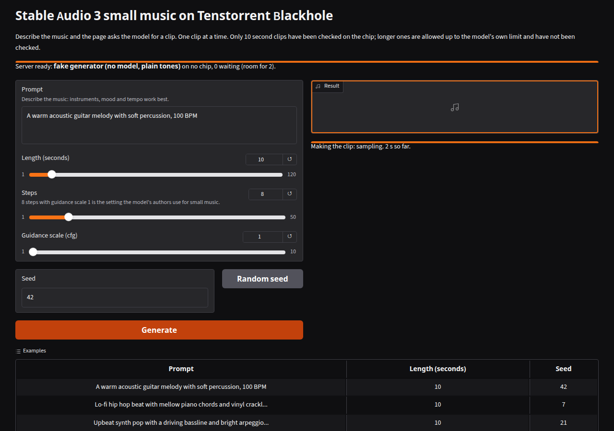
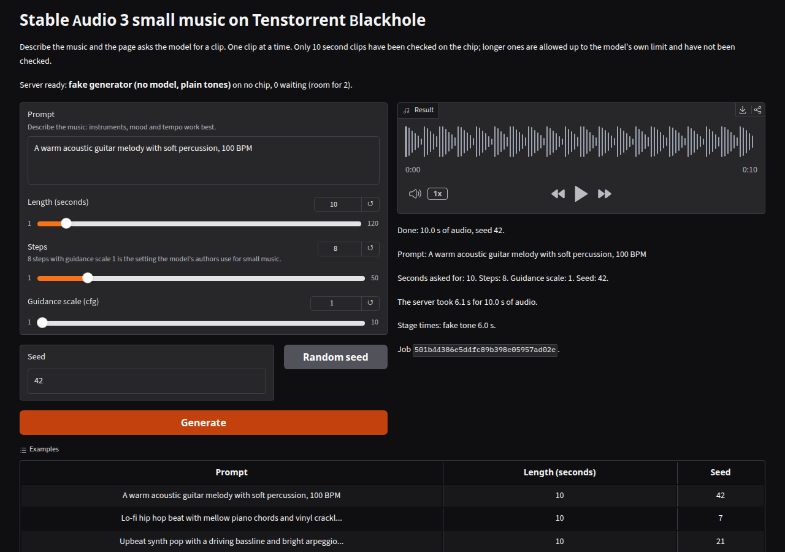
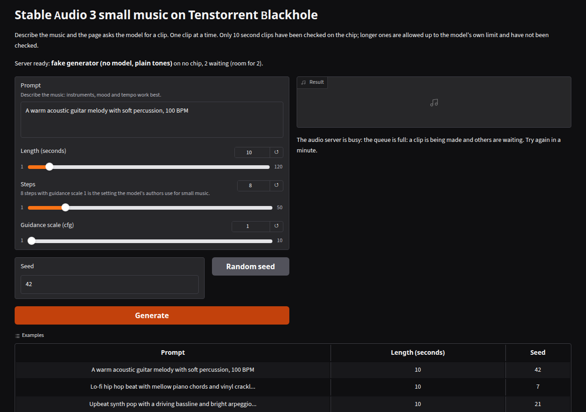

# Stable Audio 3 demo page

A local job server and a Gradio page for Stable Audio 3 small music on a Tenstorrent chip. They follow the MiniMax-Music3 page in
`tt-minimax-music-blackhole` (a prompt, a seed, a player, the settings echoed, a plain message when the server is busy). The code is in
`orchard/audio_demo/`. The three modules there are written to be copied as they are into a package's `demo/` directory.

| File | What it is |
|---|---|
| `audio_server.py` | The job server (standard library only): one clip at a time, a short queue, `--ui` to run the page after the model is ready. The generator is a plug-in: `SubprocessChipGenerator` calls the harness's `chip_generate.py`, `FakeGenerator` makes a plain tone |
| `audio_client.py` | The client for the server's API and the page's generation logic (standard library only, so the core test suite runs all of it) |
| `audio_app.py` | The Gradio page. Gradio is optional: `pip install "tt-orchard[audio-demo]"` |
| `__init__.py` | `stage_demo(package_dir)` copies the files into a package; `card_section()` is the README text for the package card |

## Run it

```
# the model on a leased chip, then the page (the lease holds while the server runs)
gozer run --chips 1 --who "claude:audio-demo" --reason "demo page" -- \
  python orchard/audio_demo/audio_server.py --generator chip --src-dir <stable-audio-3 checkout> --chip-python <python with ttnn> --ui

# no chip: the same server and page with a plain tone in place of music
python orchard/audio_demo/audio_server.py --generator fake --ui
```

The job server listens on 127.0.0.1:20100 and the page on 127.0.0.1:7872. Both bind the local machine only (`--host`, `--ui-host`). Nothing signs
anyone in. `AUDIO_URL=http://host:20100 python orchard/audio_demo/audio_app.py` runs the page against any running server.

## What the page does

The page takes a prompt, a length in seconds (up to the model's limit, 120), steps, a guidance scale and a seed, with a button for a random seed. The
default and the first example are the benchmark prompt, "A warm acoustic guitar melody with soft percussion, 100 BPM", with seed 42. After a clip it
shows the player, the settings the server used, the server's time and its stage times. It says so, in the status line, when

- the server's queue is full (HTTP 429): one clip is running and two are waiting by default;
- the server is not reachable, or the model is still loading or failed to load;
- the clip ended before the length asked for;
- the input is refused (the client checks it before any request is made, and the server checks it again).

## Limits

- The chip generator runs `chip_generate.py` once per clip, so the model is loaded again for each clip. Each clip's stage times show what that cost.
  Keeping the model resident needs `chip_generate.py` to split loading from sampling (issue linked from the pull request).
- Only 10 second clips have been checked on the chip. The page allows lengths up to the model's own limit, and `--max-seconds` lowers the limit.
- A clip that is already running cannot be stopped (stopping a process that holds the chip could leave it needing a reset). Cancelling it discards the
  clip when it ends.
- The pictures below were taken against `--generator fake`, so the clip is a plain tone and the status line says "no chip". They show the page.




